<div align="center">

# 🪐 Onix

**Um launcher para Android TV, Google TV, TVs Samsung (Tizen) e TVs LG (webOS), feito para ser rápido no controle remoto.**

Visual escuro de vidro, apps organizados do seu jeito, indicações da semana da Netflix,
notícias de games, minijogos, o **Cobalt GameHub** de jogos clássicos, troca de entradas HDMI e uma tela de descanso espacial.


-1428a0?style=flat-square&logo=samsung&logoColor=white)
-a50034?style=flat-square&logo=lg&logoColor=white)


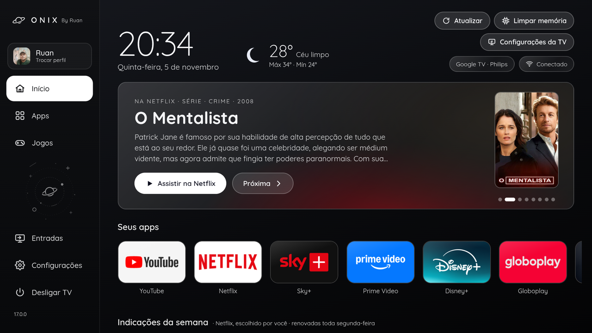

</div>

---

## Sumário

- [Novidades da 17.0.0](#novidades-da-1700)
- [Recursos](#recursos)
- [Instalação: qual é a sua TV?](#instalação)
  - [Android TV e Google TV](#android-tv-e-google-tv)
  - [TVs Samsung (Tizen)](#tvs-samsung-tizen) · beta
  - [TVs LG (webOS)](#tvs-lg-webos) · beta
- [Usar como tela inicial](#usar-como-tela-inicial)
- [Cobalt GameHub](#cobalt-gamehub-jogos-clássicos) · [Onix Controle](#onix-controle-app-de-celular)
- [Atualizações](#atualizações) · [Desligar TV](#ativar-o-botão-desligar-tv) · [Desfazer tudo](#como-desfazer-tudo)
- [Privacidade](#permissões-e-privacidade) · [Compilar](#compilar-a-partir-do-código) · [Limitações](#limitações-conhecidas)
- [🇪🇸 En español](#-en-español)

---

## Novidades da 17.1.0

- **Mais 4 temas:** **Onix Safira** (fundo do mar), **Onix Esmeralda** (floresta com vaga-lumes), **Onix Âmbar** (pôr do sol retrô) e **Onix Quartzo Rosa** (jardim japonês com cerejeiras). Agora são 9.

Da 17.0.0:

- **4 temas** em **Configurações → Aparência → Tema**, que mudam o visual inteiro: **Onix Cobalt** (pixel art), **Onix Aurora** (aurora boreal), **Onix Rubi Cinema** (cortina e projetor) e **Onix White** (claro). O Onix Escuro continua o padrão.
- **10 fontes**, que funcionam sem internet: Bodoni Moda, Cinzel, Butler, Playfair Display, Montserrat, Poppins, Bebas Neue, Orbitron, Quicksand e Press Start 2P.
- **8 estilos de relógio:** Fino, Negrito, Empilhado, Analógico, Digital, Flip, Por extenso e Neon.
- **Samsung:** novo tutorial para [ligar a TV direto no Onix](docs/samsung-tela-inicial.md).

As versões anteriores estão no [CHANGELOG.md](CHANGELOG.md) e na [página de Releases](https://github.com/ruan2311/onix/releases).

---

## Recursos

| | |
|---|---|
| **Início** | Três estilos (**Onix Glass**, **Clean Glass** e **Onix Cosmos**), destaque rotativo com as indicações da semana, fileira com os seus apps favoritos, botões **Atualizar** e **Limpar memória** |
| **Indicações da semana** | Títulos populares no Brasil (JustWatch + iTunes), renovados toda segunda. A **Netflix** é o padrão; **Disney+**, **HBO Max** e **Globoplay** entram quando você abre o app mais de 3 vezes pelo Onix (ou escolha em **Configurações → Indicações**). **Assistir no…** abre o título direto no app |
| **Apps** | Grade com todos os apps instalados, separados em **Recentes** e **Não usados** |
| **Jogos** | O cartão do [Cobalt GameHub](#cobalt-gamehub-jogos-clássicos) e quatro minijogos com fases e recorde: **Pong**, **Pinball**, **Tijolos** e **Cobrinha**. Na Samsung e na LG, um hub de jogos na nuvem (Game Pass e apps de cloud gaming) |
| **Notícias dos games** | Adrenaline e Eurogamer.pt, a cada 3 horas. **OK** abre o resumo; um QR code leva à matéria no celular |
| **Entradas** | TV (antena e cabo) e HDMI direto pelo launcher, com banners editáveis (PlayStation 5, Xbox, Switch, Computador…) |
| **Tela de descanso** | Planetas e asteroides depois de 10 minutos parado, com o relógio mudando de lugar para não marcar telas OLED |
| **Perfis e Modo Infantil** | Um perfil por pessoa, com senha opcional de 4 números; o infantil só mostra os apps liberados, tem PIN para sair e limite de tempo por dia |
| **Aparência e sons** | 9 temas, 10 fontes, 8 relógios, posição do menu (lateral, em cima ou embaixo) e 5 sons de navegação |
| **Outros** | **Desligar TV**, chip de conexão que testa a internet de verdade, clima opcional, atualizações pelo próprio app, português e español |

<details>
<summary><b>Capturas de tela</b></summary>

| Onix Cobalt | Onix Aurora |
|---|---|
| 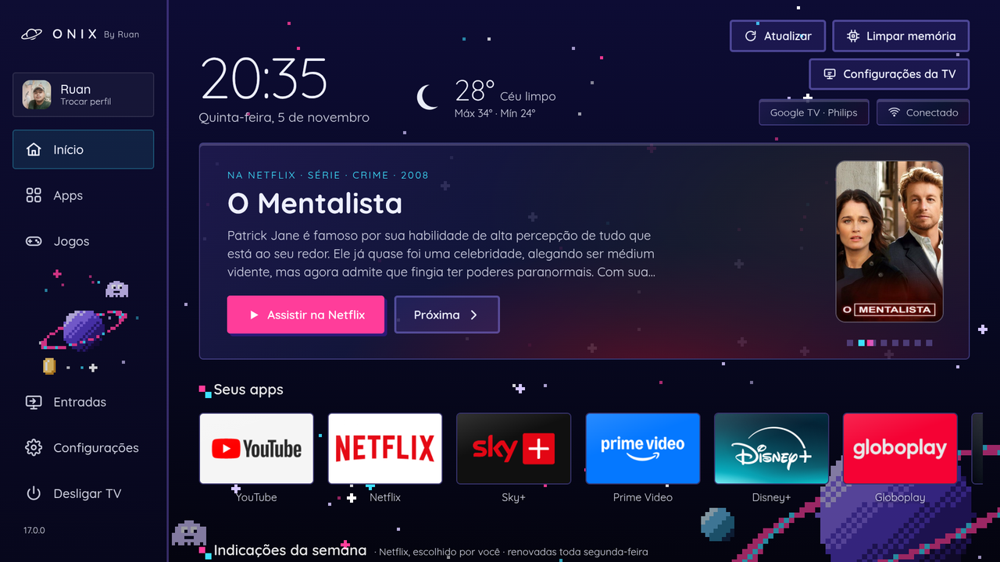 | 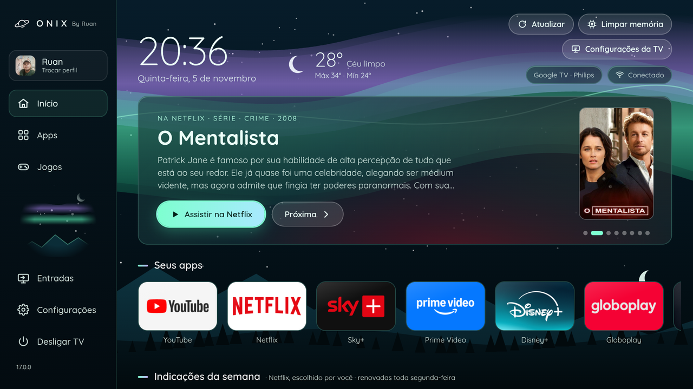 |

| Onix Rubi Cinema | Onix White |
|---|---|
| 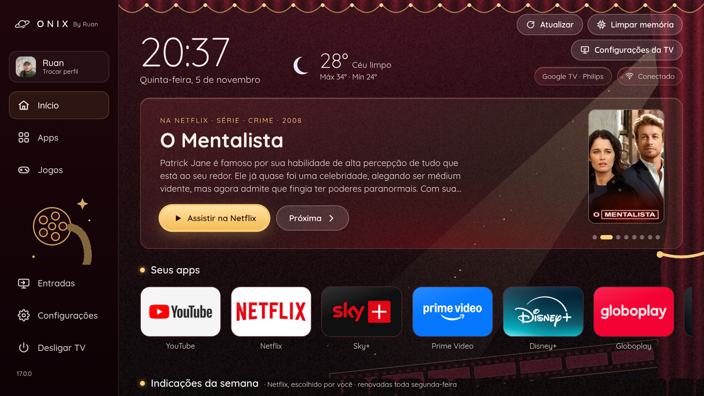 | 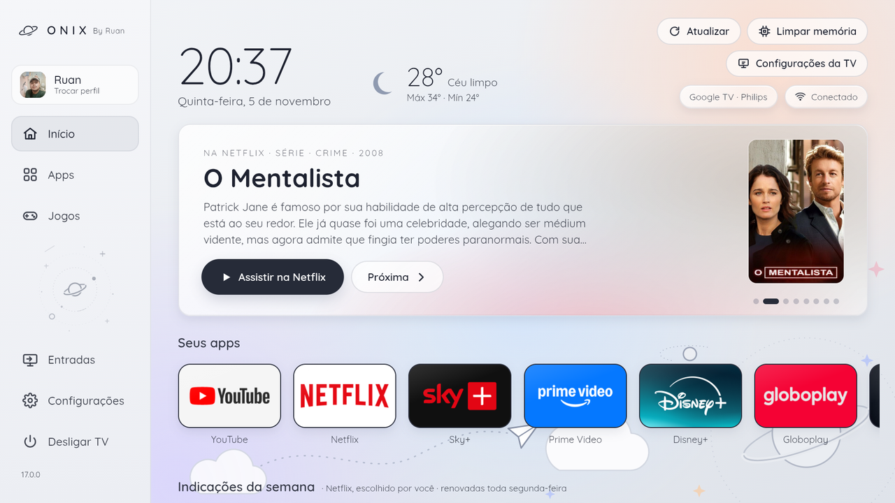 |

| Relógio Flip | Onix Cosmos |
|---|---|
| 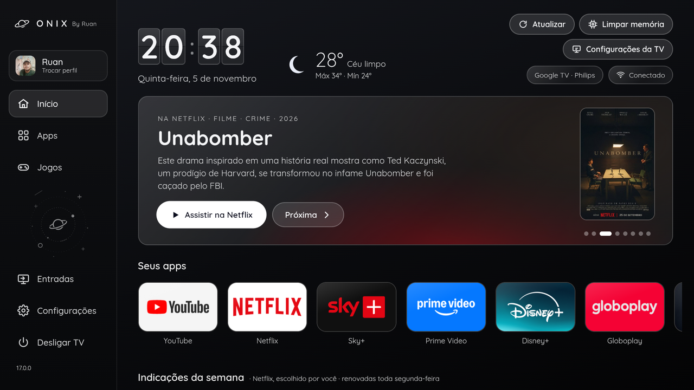 | 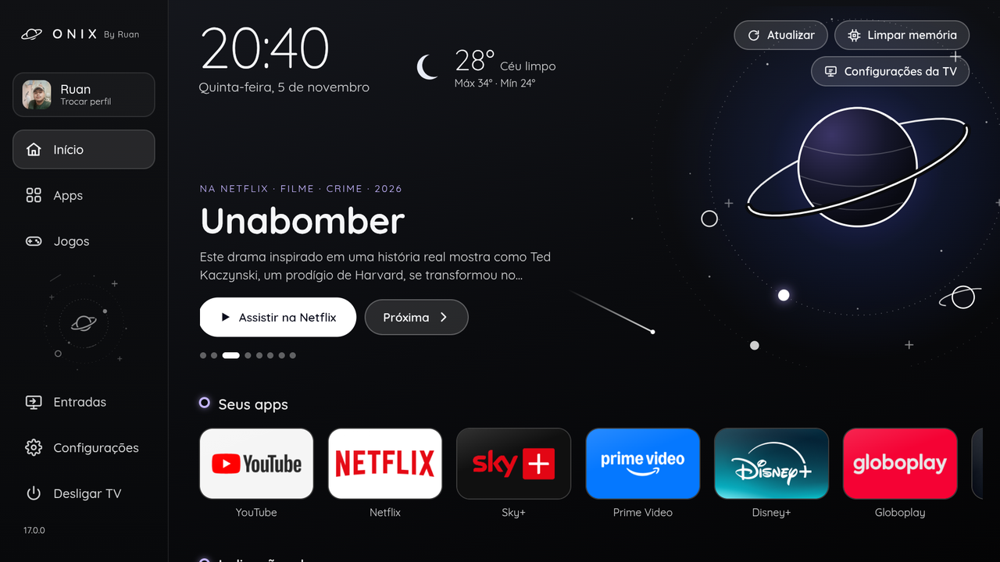 |

| Clean Glass | Modo Infantil |
|---|---|
| 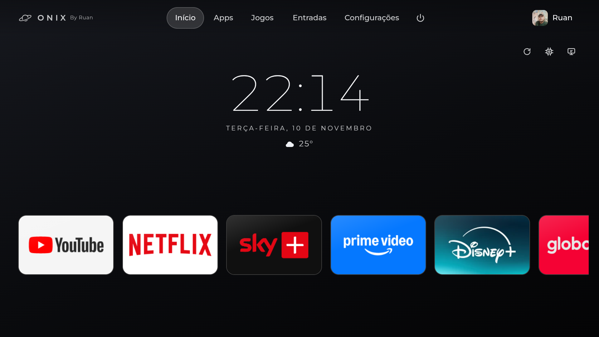 | 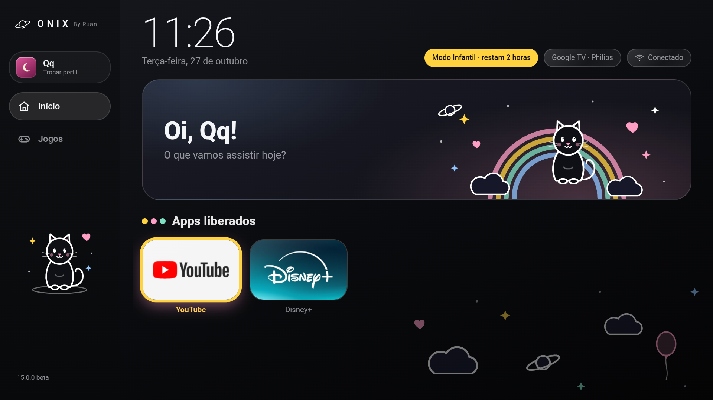 |

| Configurações | Apps |
|---|---|
| 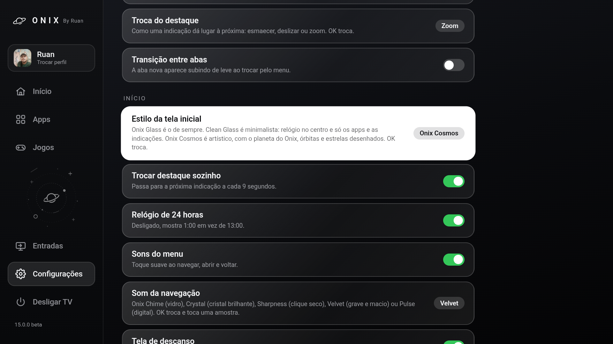 | 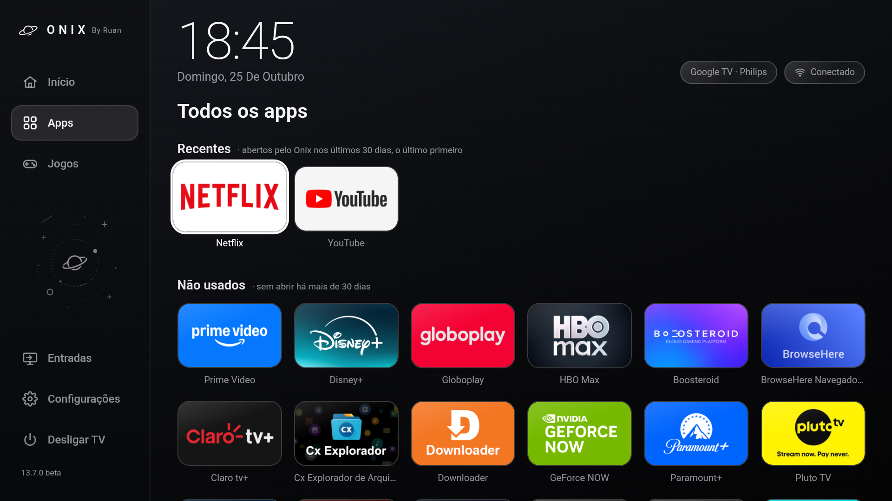 |

| Jogos e notícias | Leitor de notícias |
|---|---|
| 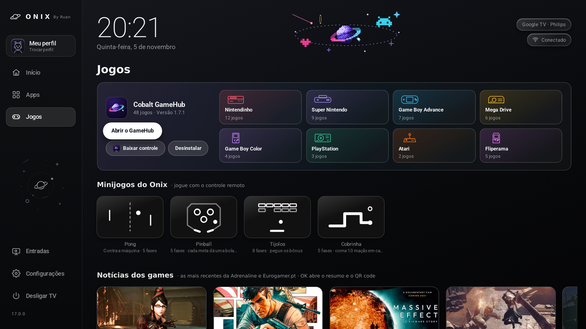 | 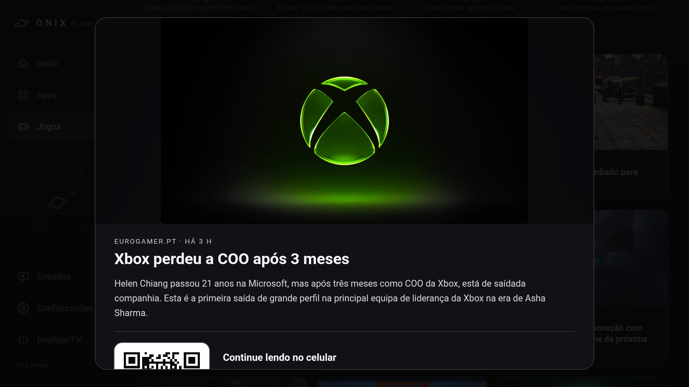 |

| Entradas | |
|---|---|
| 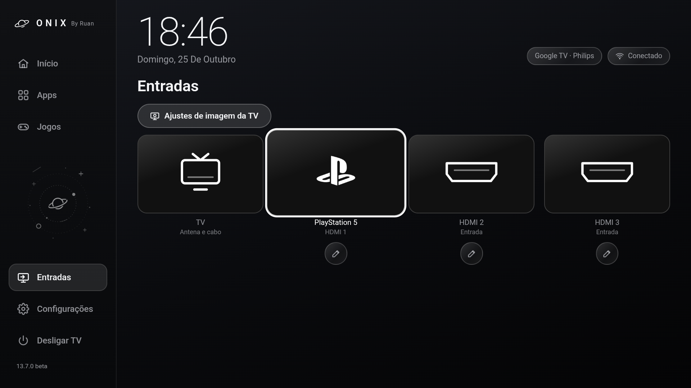 | |

</details>

---

## Instalação

| Sua TV | Como instalar |
|---|---|
| **Android TV ou Google TV** (Philips, Sony, TCL, Xiaomi, Chromecast, TV boxes…) | ✅ **Testado.** [Pela própria TV](#android-tv-e-google-tv), uns 5 minutos |
| **Samsung** (2022 ou mais nova) | 🧪 **Beta.** [Pelo celular, com o Apps2Samsung](#tvs-samsung-tizen) |
| **LG** (2022 ou mais nova) | 🧪 **Beta.** [Pelo computador, uma vez](#tvs-lg-webos) |

> **Não sabe qual é a sua?** Se a tela inicial tem a **Play Store** (ou diz "Google TV"), é Android TV/Google TV. Samsung e LG têm sistema próprio, sem a Play Store.

### Android TV e Google TV

Há dois arquivos com o mesmo conteúdo. Na dúvida, comece pelo **Onix App**; dá para instalar o Launcher por cima depois, sem perder nada.

| | **Onix App** | **Onix Launcher** |
|---|---|---|
| Arquivo | [onix-app.apk](https://github.com/ruan2311/onix/releases/latest/download/onix-app.apk) | [onix-launcher.apk](https://github.com/ruan2311/onix/releases/latest/download/onix-launcher.apk) |
| Pode virar a tela inicial | ❌ | ✅ |

1. Na TV, abra a **Play Store** e instale o **Downloader** (ícone laranja, de *AFTVnews*).
2. Abra o Downloader e clique na barra laranja **"Click here to enter a URL…"**.
3. Digite o link e clique em **Load**:
   - Onix App: **`github.com/ruan2311/onix/releases/latest/download/onix-app.apk`**
   - Onix Launcher: **`github.com/ruan2311/onix/releases/latest/download/onix-launcher.apk`**
4. Se a TV disser que o Downloader não pode instalar apps, clique em **Configurações**, ligue a chave do Downloader e aperte **Voltar**.
5. Clique em **Instalar** (ou **Atualizar**) e depois em **Abrir**.

> Se o **Play Protect** avisar que o app é desconhecido, clique em **Mais detalhes → Instalar mesmo assim**. O aviso aparece porque o Onix não vem da Play Store; o código está todo aqui.

<details>
<summary><b>Pelo computador, com adb</b></summary>

Ative as **Opções do desenvolvedor** (7 cliques em **Configurações → Sistema → Sobre → Build do sistema operacional**) e a **Depuração USB** ou **sem fio**. Depois:

```bash
adb connect IP_DA_TV:5555
adb install -r onix-app.apk      # ou onix-launcher.apk
```

</details>

### TVs Samsung (Tizen)

A versão Samsung é a mesma interface, empacotada como app do Tizen (`.wgt`). Funciona em TVs de **2022 em diante**. A Samsung só instala apps de fora da loja **assinados para a sua TV** com uma conta Samsung, e o app de celular abaixo faz isso por você.

Você vai precisar de: um **celular Android**, uma **conta Samsung** e os dois aparelhos **no mesmo Wi-Fi**.

1. **Anote o IP do celular** (**Configurações → Wi-Fi →** a rede conectada), algo como `192.168.0.25`.
2. **Ligue o Modo Desenvolvedor da TV:** abra **Apps**, digite **1 2 3 4 5** no controle (ou pelo botão **123**), ligue **Developer mode**, digite o IP do celular e **desligue e ligue a TV**.
3. **Instale o [Apps2Samsung](https://github.com/Apps2Samsung/Apps2Samsung/releases/latest)** no celular (o arquivo que termina em `-android.apk`). É um app gratuito de outro desenvolvedor.
4. **Baixe o [onix-tizen.wgt](https://github.com/ruan2311/onix/releases/latest/download/onix-tizen.wgt)** no celular.
5. **Instale:** no Apps2Samsung, escolha a TV, **instalar um .wgt próprio** (custom .wgt) e o `onix-tizen.wgt`. Na primeira vez, ele pede a conta Samsung para assinar o app.
6. **Pronto:** o Onix aparece em **Apps**. Depois, você pode desligar o Modo Desenvolvedor.

> **Ligar a TV direto no Onix:** siga o tutorial [Samsung: ligar a TV direto no Onix](docs/samsung-tela-inicial.md). Usa só as configurações da TV e dá para desfazer quando quiser.

> **Atualizar:** baixe o `.wgt` novo e repita o passo 5; nada se perde. **Desinstalar:** **Apps → ⚙️ → Onix → Excluir**.

<details>
<summary><b>Pelo computador, com o Tizen Studio</b> (oficial da Samsung)</summary>

1. Instale o [Tizen Studio](https://developer.tizen.org/development/tizen-studio/download) (a versão CLI basta) e, no **Package Manager → Extension SDK**, a **Samsung Certificate Extension** e as **TV Extensions**.
2. Ligue o Modo Desenvolvedor da TV como no passo 2 acima, com o **IP do computador**.
3. Conecte: `sdb connect IP_DA_TV` e `sdb devices` (anote o nome da TV).
4. No **Certificate Manager**, crie um perfil **Samsung → TV** chamado `Onix`: um *author certificate* novo e o *distributor* com privilégio **Public** (o DUID da TV aparece sozinho). Entre com a conta Samsung quando pedir.
5. Baixe e extraia o [onix-tizen.zip](https://github.com/ruan2311/onix/releases/latest/download/onix-tizen.zip) e rode:

```bash
tizen package -t wgt -s Onix -- onix
tizen install -n Onix.wgt -t NOME_DA_TV -- onix
```

</details>

#### O que muda na Samsung

| Recurso | Na Samsung |
|---|---|
| Apps, Jogos, Notícias, Tela de descanso | ✅ Igual ao Android |
| Aba Jogos | 🎮 Hub de jogos na nuvem (Game Pass e apps de cloud gaming) no lugar do Cobalt GameHub |
| Indicações + **Assistir na Netflix** | ✅ Abre o título. Disney+, HBO Max e Globoplay abrem o app, nem sempre direto no título |
| Entradas TV e HDMI | ⚠️ Em tela cheia **dentro do Onix**; Voltar ou OK retorna. Para jogar, prefira o botão de fontes do controle (o Modo Jogo pode não ligar) |
| Ligar a TV no Onix | ✅ Pelo [Executar último app](docs/samsung-tela-inicial.md) |
| Botão Home | ❌ Continua abrindo o Smart Hub; dá para pôr o Onix em primeiro na barra |
| Atualizações | ⚠️ O Onix avisa, mas você instala do mesmo jeito da primeira vez |
| Desligar TV e ajustes da TV | ❌ O Tizen não deixa apps comuns fazerem isso |

### TVs LG (webOS)

A versão LG é a mesma interface, como app do webOS (`onix-webos.ipk`), para TVs de **2022 em diante** (webOS 22+). A LG só instala apps de fora da loja pelo **computador**, uma vez.

1. **Crie uma conta de desenvolvedor** em [webostv.developer.lge.com](https://webostv.developer.lge.com/) (grátis, diferente da conta LG da TV).
2. **Na TV**, instale o app **Developer Mode** da loja, entre com essa conta e ligue **Dev Mode Status** (a TV reinicia). Abra de novo e ligue **Key Server**: a tela mostra o **IP** e a **Passphrase**.
3. **No computador**, instale o [webOS Dev Manager](https://github.com/webosbrew/dev-manager-desktop/releases/latest) e use **Add Device** com o IP e a Passphrase.
4. Baixe o [onix-webos.ipk](https://github.com/ruan2311/onix/releases/latest/download/onix-webos.ipk) e instale pelo Dev Manager (**Apps → Install**).

> ⏳ **O Modo Desenvolvedor vence em 50 horas** e, quando vence, a LG apaga o Onix. De vez em quando, abra o **Developer Mode** e aperte **Extend**. Com o [Homebrew Channel](https://github.com/webosbrew/webos-homebrew-channel) (root), ele não expira.

<details>
<summary><b>Pelo terminal, com o webOS CLI</b></summary>

```bash
npm install -g @webos-tools/cli
ares-setup-device                          # "add": nome tv, IP da TV, porta 9922, usuário prisoner
ares-novacom --device tv --getkey          # pede a Passphrase
ares-install --device tv onix-webos.ipk
```

</details>

**O que muda na LG:** igual à Samsung, com duas diferenças boas: as **entradas** trocam a TV inteira, como o botão de fontes, e as **configurações da TV** abrem pelo Onix. Não vira tela inicial e não desliga a TV.

---

## Usar como tela inicial

| TV | Como |
|---|---|
| **Android TV clássico** | Instale o **Onix Launcher**, aperte **Home** e escolha **Onix Launcher → Sempre** |
| **Google TV** | Desative a tela inicial do Google (passos abaixo). Ela não é apagada e volta quando quiser |
| **Samsung** | O Home não muda, mas a TV pode [ligar direto no Onix](docs/samsung-tela-inicial.md) |
| **LG** | Não dá; traga o Onix para o começo da barra de apps |

**Google TV** (✅ *testado numa Philips Google TV, Android TV 14*):

> ⚠️ Antes, abra o **Onix Launcher** pela lista de apps e confirme que ele funciona. Sem nenhuma tela inicial ativa, a TV fica sem tela inicial.

1. Ative as **Opções do desenvolvedor** (7 cliques em **Configurações → Sistema → Sobre → Build do SO do Android TV**) e ligue a **Depuração USB** (e a **sem fio**, se existir).
2. No celular, instale o **Bugjaeger Mobile ADB** (Play Store) e conecte por Wi-Fi em `IP_DA_TV:5555`. Na TV, marque **Sempre permitir**.
3. No terminal do Bugjaeger (ou com `adb shell` na frente, pelo computador), rode:

```
pm disable-user --user 0 com.google.android.apps.tv.launcherx
pm disable-user --user 0 com.google.android.tungsten.setupwraith
```

4. Aperte **Home**: o Onix abre direto. No Android TV clássico, o comando é `pm disable-user --user 0 com.google.android.tvlauncher`.

---

## Cobalt GameHub (jogos clássicos)


App **opcional**, no visual do Onix, para jogar **NES, Super Nintendo, Game Boy Advance, Game Boy Color, Mega Drive, PlayStation, Atari e Fliperama** na **Google TV e Android TV** (também há versões para celular, PC e iPhone). Instale pela aba **Jogos** do Onix: o perfil, o idioma, o Modo Infantil e o "Continuar jogando" vêm de lá. Os jogos chegam pelo celular, com um QR code, ou direto de um pendrive ou HD.

> ⚖️ **Nenhum jogo vem com o GameHub.** Use só jogos que você tem o direito de usar.

Tudo sobre ele no [README do Cobalt GameHub](gamehub/README.md) e nas [Releases do ruan2311/cobalt-gamehub](https://github.com/ruan2311/cobalt-gamehub/releases).

<p align="center">
  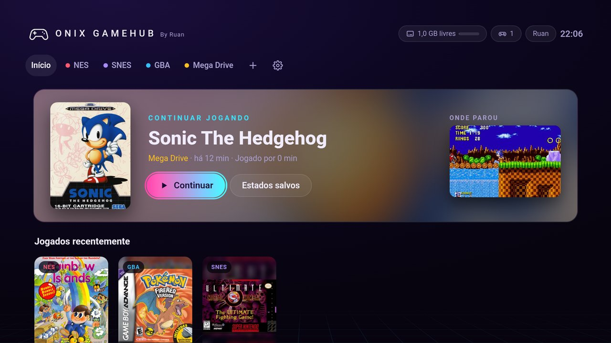
  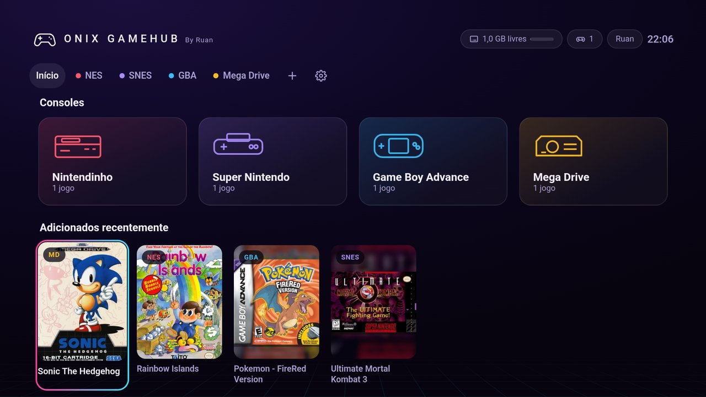
</p>

---

## Onix Controle (app de celular)

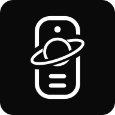

Transforma o celular no **controle remoto da TV inteira** (dentro da Netflix, do YouTube, das configurações…) e num **gamepad** para o Cobalt GameHub, pelo Wi-Fi de casa. Funciona em **Google TV e Android TV**, não em Samsung e LG.

- Setas ou deslizar, **OK**, **Voltar**, **Início**, ligar/desligar, volume (inclusive pelos botões do celular) e mídia.
- **Teclado do celular** aparece sozinho quando a TV abre uma busca.
- Atalhos para YouTube, Netflix, Prime Video, Disney+ e Max, e o nome do app aberto na TV.

**Android (6+):** baixe o **[onix-controle.apk](https://github.com/ruan2311/onix/releases/download/controle-v1.0.8/onix-controle.apk)** (ou pelo QR code em **Configurações → Controle pelo celular** no Onix), instale, toque na sua TV e digite o código de 6 caracteres que aparece nela. Ele se atualiza pelo GitHub em **Configurações → Atualização**.

**iPhone e iPad:** o Safari não deixa um site controlar a TV, então funciona **só como controle do Cobalt GameHub**. No GameHub, escolha **Usar celular como controle** e aponte a câmera, ou abra [projectgems.github.io/onix/controle](https://projectgems.github.io/onix/controle).

> O **QR code rápido do Onix** (sem instalar nada) continua existindo: ele controla só o Onix, pelo navegador.

---

## Atualizações

No Android, o Onix confere a [página de Releases](https://github.com/ruan2311/onix/releases) ao abrir e a cada 6 horas. Com **Atualizar automaticamente** ligado (padrão), ele baixa a versão nova, confere o **SHA-256** e abre a tela de instalação: é só apertar **Instalar**. Na primeira vez, o Android pede para permitir que o Onix instale apps. Nada se perde na atualização.

Na **Samsung e na LG**, o Onix só avisa; instale o arquivo novo do mesmo jeito que o primeiro.

## Ativar o botão "Desligar TV"

O Onix se registra como **administrador do dispositivo** com uma única política, *bloquear a tela*, que na TV coloca o aparelho em standby. Aperte **Desligar TV** duas vezes e aceite o pedido. Se a TV não mostrar o pedido, pelo computador:

```bash
adb shell dpm set-active-admin com.aurora.launcher/.PowerAdmin
```

## Como desfazer tudo

- **Desinstalar (Android):** **Configurações → Apps → Onix → Desinstalar**, ou `adb uninstall com.aurora.launcher`. Se o **Desligar TV** estiver ativo, desative antes em **Configurações → Segurança → Apps de administrador do dispositivo**.
- **Trazer de volta a tela do Google:** `pm enable com.google.android.apps.tv.launcherx`, `pm enable com.google.android.tungsten.setupwraith` e `pm enable com.google.android.tvlauncher` (pelo Bugjaeger, ou com `adb shell` na frente).
- **Samsung:** desligue **Executar último app automaticamente** ([detalhes](docs/samsung-tela-inicial.md#como-desfazer)) e exclua o Onix em **Apps → ⚙️**.

---

## Permissões e privacidade

- **Sem rastreamento, sem anúncios, sem conta.** Preferências, perfis, PIN e contagem de uso dos apps ficam **só na TV**.
- A interface roda num WebView **offline**, com uma Content-Security-Policy que bloqueia a rede. Os downloads são feitos pelo código nativo, só por HTTPS e só destes serviços: JustWatch e iTunes (indicações), Adrenaline e Eurogamer.pt (notícias), GitHub (atualizações), `connectivitycheck.gstatic.com` (teste de internet) e Open-Meteo (clima, só se você ligar).
- Permissões do Android: `INTERNET`, `ACCESS_NETWORK_STATE`, `RECEIVE_BOOT_COMPLETED` (agenda das indicações), `REQUEST_INSTALL_PACKAGES` (atualizações, sempre com confirmação) e, opcional, o administrador do dispositivo só com `force-lock`.
- **Controle pelo celular:** com o Onix aberto, atende na porta `8765`, só na rede de casa, com a chave do QR code (muda a cada conexão e uma vez por dia). Dá para desligar em **Configurações → Controle pelo celular**.
- **Onix Controle:** fala direto com a TV nas portas `6466` e `6467`, com TLS e certificado da TV guardado no pareamento. Na internet, só acessa o GitHub.

---

## Compilar a partir do código

Sem Gradle nem Android Studio, só pacotes do Ubuntu/Debian:

```bash
sudo apt install openjdk-17-jdk-headless libandroid-23-java dalvik-exchange aapt zipalign apksigner
git clone https://github.com/ruan2311/onix.git && cd onix

bash android/build.sh launcher   # onix-launcher.apk
bash android/build.sh app        # onix-app.apk (sem as categorias HOME/DEFAULT)
bash controle/build.sh           # onix-controle.apk
bash tizen/build.sh [PERFIL]     # Samsung: onix-tizen.wgt/.zip (e Onix.wgt assinado, com um perfil)
bash webos/build.sh              # LG: onix-webos.ipk
```

- A **versão** vem do `android:versionName` do `android/AndroidManifest.xml` e vai para todos os builds.
- Ao lançar, atualize a lista `CHANGELOG` do `index.html` (tela **Novidades**) junto com o [CHANGELOG.md](CHANGELOG.md).
- Os APKs saem assinados com a chave de debug do seu computador: não instalam por cima dos APKs deste repositório (e vice-versa).
- **Testar no navegador:** `python3 -m http.server 8000` e abra `http://localhost:8000/index.html` (setas e Enter fazem de controle).

<details>
<summary><b>Estrutura do projeto</b></summary>

```
.
├── index.html          # Toda a interface: HTML, CSS e JS num arquivo só
├── android/            # App Android: MainActivity, AndroidBridge, indicações, notícias, atualizações
├── tv/                 # Comum às TVs sem Android: bridge.js (a mesma ponte em JS) e page.py (monta o index.html)
├── tizen/              # Samsung: platform.js (APIs do Tizen), config.xml e build.sh
├── webos/              # LG: platform.js (serviços Luna), appinfo.json, ipk.py e build.sh
├── controle/           # Onix Controle (celular): protocolo de controle da Google TV
├── gamehub/            # Cobalt GameHub (TV, celular, PC e iPhone)
└── docs/               # Tutoriais e capturas de tela
```

A página conversa com o aparelho pelo objeto `AndroidBridge` (`getInstalledApps()`, `launchApp()`, `openPick()`…) e recebe as novidades em `window.Launcher.onAppsChanged()`, `onPicksChanged()` etc. Na Samsung e na LG, o `tv/bridge.js` cria esse mesmo `AndroidBridge` em JavaScript, e só o adaptador de cada TV muda.

**Personalizar:** banners de entrada em `INPUT_BANNERS` (`index.html`), fontes de notícias em `FEEDS` (`GameNews.java`), serviços das indicações em `PROVIDERS` (`WeeklyPicks.java` e `tv/bridge.js`), tempo da tela de descanso em `SAVER_IDLE`.

</details>

---

## Limitações conhecidas

- **"Continuar assistindo" da Google TV:** exige permissões reservadas a apps de sistema.
- **Botão Home:** na Google TV, só depois de desativar o launcher do Google; na Samsung e na LG, não muda.
- **Desligar TV** depende do recurso de administrador do dispositivo, que alguns aparelhos não têm.
- **Indicações e notícias** são focadas no Brasil e em português.
- **TV boxes antigas:** se algo aparecer estranho, atualize o **Android System WebView** pela Play Store (a versão aparece em **Configurações → Sobre → Navegador da TV**).
- **LG:** pelo Modo Desenvolvedor, é preciso renovar a sessão a cada 50 horas.

---

## 🇪🇸 En español

Onix está en **español**: en **Configuración → Idioma**, elige *Español* o *Automático*. Las noticias y las sinopsis siguen en portugués.

**Instalar en Android TV / Google TV:** en la TV, instala **Downloader** (de *AFTVnews*) desde Play Store, ábrelo, toca la barra naranja, escribe el enlace y toca **Load**:

- Onix App: **`github.com/ruan2311/onix/releases/latest/download/onix-app.apk`**
- Onix Launcher (puede ser la pantalla de inicio): **`github.com/ruan2311/onix/releases/latest/download/onix-launcher.apk`**
- Onix Controle 1.0.8 (el celular Android como control remoto de la TV y control de Cobalt GameHub): **[onix-controle.apk](https://github.com/ruan2311/onix/releases/download/controle-v1.0.8/onix-controle.apk)**

Si Downloader no puede instalar apps, actívalo en **Configuración** y vuelve. Si **Play Protect** avisa, toca **Más detalles → Instalar de todos modos**.

**Novedades de la 17.1.0:** **4 temas más**: *Onix Zafiro* (fondo del mar), *Onix Esmeralda* (bosque con luciérnagas), *Onix Ámbar* (atardecer retro) y *Onix Cuarzo Rosa* (jardín japonés con cerezos). **De la 17.0.0:** **4 temas** (*Onix Cobalt*, *Onix Aurora*, *Onix Rubí Cine* y *Onix White*), **10 fuentes** y **8 estilos de reloj** en **Configuración → Apariencia**. El historial completo está en el [CHANGELOG.md](CHANGELOG.md) (en portugués).

---

## Créditos

Criado por **Ruan Amaral** · Instagram [@ruan_amarl](https://instagram.com/ruan_amarl) · Distribuído sob a [licença MIT](LICENSE).

PlayStation, Xbox, Nintendo Switch, Netflix e os demais nomes citados são marcas de seus donos e aparecem só para identificar aparelhos e serviços. Indicações via [JustWatch](https://www.justwatch.com) e iTunes; notícias da [Adrenaline](https://www.adrenaline.com.br) e da [Eurogamer.pt](https://www.eurogamer.pt).
