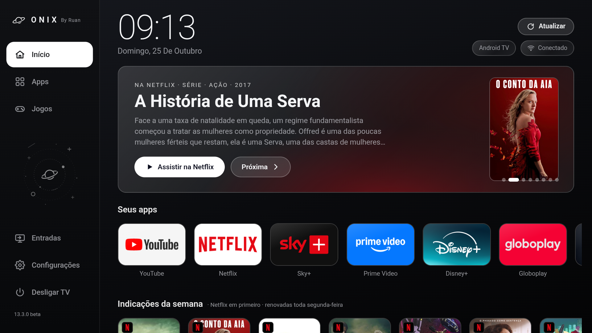
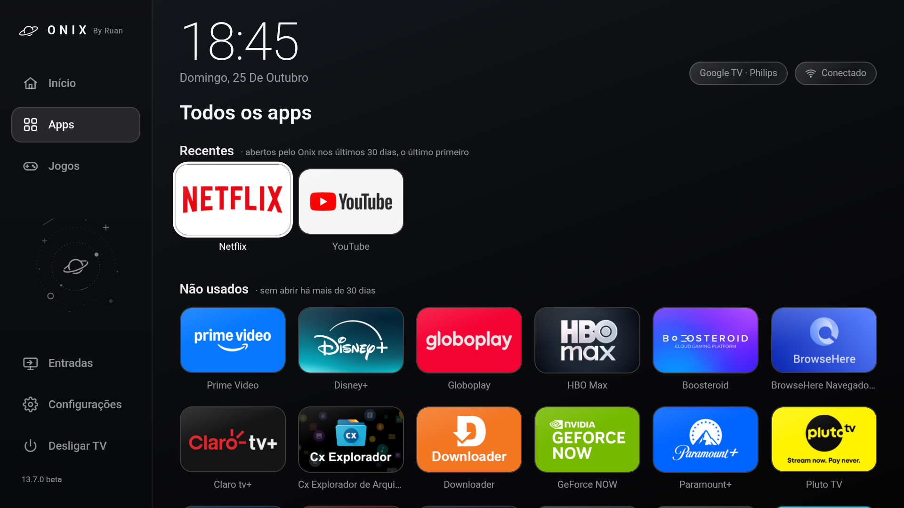
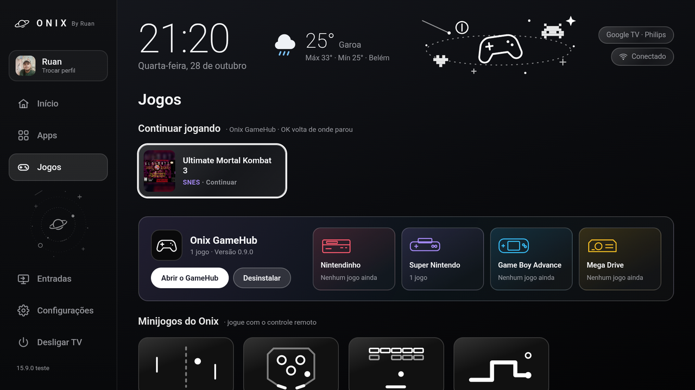
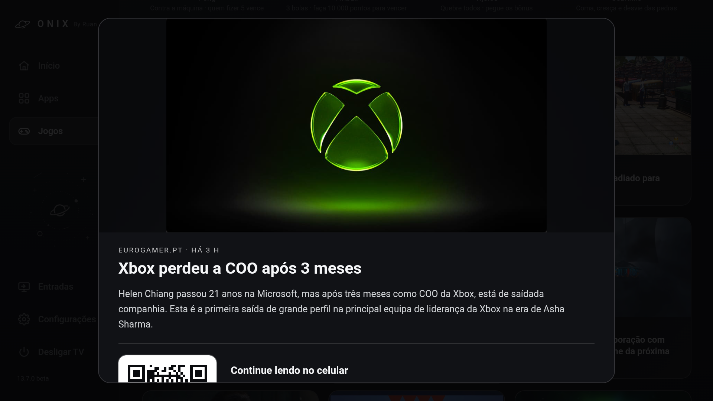
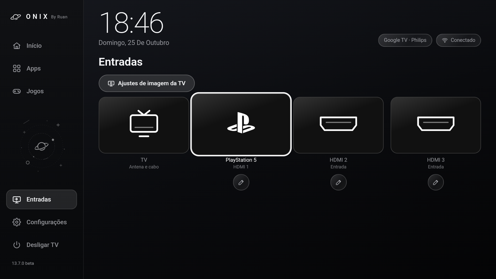

<div align="center">

# 🪐 Onix

**Um launcher para Android TV, Google TV, TVs Samsung (Tizen) e TVs LG (webOS), feito para ser rápido no controle remoto.**

Visual escuro de vidro, apps organizados do seu jeito, indicações da semana da Netflix,
notícias de games, jogos embutidos, troca de entradas HDMI e uma tela de descanso espacial.


-1428a0?style=flat-square&logo=samsung&logoColor=white)
-a50034?style=flat-square&logo=lg&logoColor=white)




</div>

---

## Sumário

- [🇪🇸 En español](#-en-español)
- [Novidades da 14.0.0](#novidades-da-1400)
- [Recursos](#recursos)
- [Capturas de tela](#capturas-de-tela)
- [Instalação: qual é a sua TV?](#instalação)
- [Android TV e Google TV](#android-tv-e-google-tv)
- [TVs Samsung (Tizen) · experimental](#tvs-samsung-tizen)
- [TVs LG (webOS) · experimental](#tvs-lg-webos)
- [Usar como tela inicial (Onix Launcher)](#usar-como-tela-inicial-onix-launcher)
- [Atualizações automáticas](#atualizações-automáticas)
- [Ativar o botão "Desligar TV"](#ativar-o-botão-desligar-tv)
- [Como desfazer tudo](#como-desfazer-tudo)
- [Permissões e privacidade](#permissões-e-privacidade)
- [Compilar a partir do código](#compilar-a-partir-do-código)
- [Estrutura do projeto](#estrutura-do-projeto)
- [Personalização](#personalização)
- [Limitações conhecidas](#limitações-conhecidas)
- [Créditos](#créditos)

---

## 🇪🇸 En español

Onix está en **español**: en **Configuración → Idioma**, elige *Português*, *Español* o *Automático* (sigue el idioma de la TV). Las noticias de videojuegos y las sinopsis de las recomendaciones vienen de sitios brasileños y siguen en portugués.

**Instalar en Android TV / Google TV con la app Downloader:**

1. En la TV, abre **Play Store**, busca **Downloader** (ícono naranja, de *AFTVnews*) e instálala.
2. Abre **Downloader** y haz clic en la barra naranja de arriba (**"Click here to enter a URL…"**).
3. Escribe el enlace y haz clic en **Load**:
   - Onix App: **`github.com/ruan2311/onix/releases/latest/download/onix-app.apk`**
   - Onix Launcher (puede ser la pantalla de inicio): **`github.com/ruan2311/onix/releases/latest/download/onix-launcher.apk`**
4. Si la TV dice que Downloader no puede instalar apps, entra en **Configuración**, activa **Downloader** y pulsa **Volver**.
5. Haz clic en **Instalar** y después en **Abrir**.

> Si **Play Protect** avisa que la app es desconocida, haz clic en **Más detalles → Instalar de todos modos**. Aparece porque Onix no viene de Play Store; el código es abierto y está todo en este GitHub.

---

## Novidades da 14.0.0

> 🚧 **Em produção.** A 14.0.0 ainda não saiu: a versão atual é a 13.7.6. Quando ela for lançada, o Onix avisa e se atualiza sozinho.

- **Perfis.** Uma tela *Quem está assistindo?* com um avatar para cada pessoa da casa. Cada perfil tem os seus apps, recentes, indicações, recordes dos jogos e idioma. Com um perfil só, o Onix entra direto, sem perguntar nada. Quem já usa o Onix vira o primeiro perfil, sem perder nada.
- **Foto de perfil pelo celular.** Escolha uma foto da galeria do celular, recorte e mande para a TV pelo QR code. A foto fica só na TV.
- **Boas-vindas.** Na primeira vez, o Onix ajuda a escolher o idioma, criar o seu perfil e acertar algumas preferências. Tudo dá para pular e mudar depois.
- **Modo Infantil.** Um perfil para crianças que mostra só os apps liberados, com PIN para sair e limite de tempo por dia.
- **Controle pelo celular.** Leia o QR code da TV e o celular vira controle e teclado, sem instalar nada: setas e OK, busca digitando com o teclado do próprio celular e "Seus apps" organizados na tela do celular. Funciona com o Onix na tela, no Android TV e no Google TV.
- **Clima na tela inicial (opcional).** A temperatura ao lado do relógio e, com OK, a previsão das próximas horas e dos próximos 5 dias (dados do Open-Meteo). O Onix não detecta onde você está: só usa a cidade que você escolher nas Configurações.

Na 13.7.5: os jogos ganharam o visual do Onix e fases. Na 13.7.4: o Onix passou a falar **espanhol**.

Na 13.6.0: atualizações pelo próprio Onix, escolha dos serviços das indicações, o aparelho no chip do topo e o "Conectado" que testa a internet de verdade.

Na 13.7.0: versão para **TVs LG (webOS)**, em beta e ainda sem teste numa LG de verdade. Veja [TVs LG (webOS)](#tvs-lg-webos).

Na 13.6.4: etiquetas **Novo**, **Correção** e **Bug** nas Novidades, e um segredo no cartão **Sobre**.

Na 13.6.3: o Onix não some mais com os apps, as entradas e as indicações ao voltar de outro app; aviso "Parece que você está sem conexão" no lugar dos destaques de fachada; **Configurações da TV** ao lado do **Atualizar**; novos estilos de animação; e a aba **Apps** separada em **Recentes** e **Não usados**.

Na 13.6.2: ícones oficiais do Disney+, da HBO Max e do Globoplay nos selos das indicações, e TV, PlayStation 5, Xbox e Nintendo Switch com o mesmo visual das HDMI em **Entradas**.

Na 13.6.1: a entrada **TV** (antena e cabo) em **Entradas** e os pontinhos do destaque centralizados embaixo da capa.

Na 13.5.0: indicações do Disney+, HBO Max e Globoplay pelo uso, a tela **Novidades** e a versão para TVs Samsung.

O histórico completo está no [CHANGELOG.md](CHANGELOG.md) e na [página de Releases](https://github.com/ruan2311/onix/releases).

---

## Recursos

### Início
- **Destaque rotativo** com as indicações da semana. O botão **Assistir na Netflix** abre o título direto na página dele no app da Netflix.
- **Seus apps**: uma fileira com os seus apps favoritos. Dá para adicionar, remover e reordenar na tela **Organizar seus apps**.
- **Indicações da semana**: títulos populares no Brasil (via JustWatch) dos serviços que você usa, complementados pelos filmes mais vistos da iTunes Store. A lista é renovada toda segunda-feira.
  - A **Netflix** é o padrão e está sempre presente.
  - **Disney+**, **HBO Max** e **Globoplay** entram quando você abre o app **mais de 3 vezes pelo Onix** (pela grade ou pelas indicações) e o app está instalado. As 8 vagas são divididas entre os serviços, e os mais abertos vêm primeiro.
  - Uma **semana sem abrir** o app zera a contagem e ele sai das indicações.
  - Prefere escolher? Em **Configurações → Indicações**, desligue **Pelo que você assiste** e marque os serviços que quiser (pelo menos um).
  - Cada indicação tem o selo do serviço, e **Assistir no…** abre o título direto no app.
- **Botão Atualizar**: baixa notícias, indicações e a lista de apps na hora, sem esperar o próximo ciclo automático.
- **Botão Limpar memória**: fecha os apps parados em segundo plano (nunca o próprio Onix) e mostra quanto liberou. No Android 14 ou mais novo, o sistema não deixa um app fechar outros, e o botão só mostra a memória livre.

### Apps
- Grade com todos os apps instalados, com o banner oficial de TV de cada um quando existir.

### Jogos
Quatro jogos feitos para o controle remoto, no visual do Onix (traços coloridos sobre o vidro escuro), com fases, música chiptune e recorde salvo:

| Jogo | Fases | Poderes e malefícios |
|---|---|---|
| **Pong** | 5 fases: quem fizer 5 pontos passa; a máquina fica mais rápida a cada uma | `+` raquete maior · `−` raquete menor · `»` turbo · `\|\|` congela o adversário |
| **Pinball** | 5 metas (10.000 a 100.000 pontos); cada uma dá uma bola extra | Faixas que sobem o multiplicador, alvos e bumpers |
| **Tijolos** | 8 fases, cada uma com um desenho de tijolos | Bons: **W** larga, **♥** vida, **S** lenta, **F** fogo · Ruins: **−** curta, **R** rápida |
| **Cobrinha** | 5 fases de 10 maçãs, com muros novos em cada | Pedras surgem a cada 3 maçãs; a maçã dourada vale 50 |

### Notícias dos games
- As últimas notícias da **Adrenaline** e da **Eurogamer.pt**, atualizadas a cada 3 horas.
- **OK** abre um resumo dentro do próprio Onix. No fim, um **QR code** leva à matéria completa no celular, já que a maioria das TVs não tem navegador.

### Entradas (TV e HDMI)
- **TV** (antena e cabo) como primeira entrada: abre os canais abertos no app de TV do aparelho, mesmo se ele estava numa HDMI. Só aparece em TVs com sintonizador.
- Troca de entrada HDMI direto pelo launcher.
- **Banners editáveis**: a canetinha embaixo de cada porta alterna entre PlayStation 5, Xbox, Nintendo Switch, Videogame, Computador ou HDMI genérico.
- Atalho para os **ajustes de imagem** da TV.

### Tela de descanso
- Depois de 10 minutos sem usar o controle, planetas e asteroides passam devagar sobre um céu preto, com relógio e estrelas cadentes.
- O relógio muda de posição a cada minuto, para não marcar telas OLED.

### Outros
- **Desligar TV** no menu: pede confirmação com um segundo OK e coloca a TV em standby.
- **Aparelho e conexão no topo**: o chip da esquerda mostra o aparelho (*Google TV · Philips*, *Android TV*, *Celular Android*…) e o da direita fica vermelho com **Sem internet** quando a internet cai, mesmo com o Wi-Fi ligado (teste a cada 30 s).
- **Atualizações**: o Onix avisa quando sai uma versão nova e se atualiza pelo próprio app. Veja [abaixo](#atualizações-automáticas).
- **Português e español**: em **Configurações → Idioma**, escolha o idioma ou deixe no automático (segue o idioma da TV).
- **Configurações do Onix**: desliga efeitos visuais para TVs mais fracas e controla relógio de 24 h, sons do menu e tela de descanso.

---

## Capturas de tela

| Apps | Jogos e notícias |
|---|---|
|  |  |

| Leitor de notícias | Entradas |
|---|---|
|  |  |

---

## Instalação

### Qual é a sua TV?

| Sua TV | Como instalar |
|---|---|
| **Android TV ou Google TV** (Philips, Sony, TCL, Xiaomi, AOC, Chromecast, TV boxes…) | ✅ **Testado.** [Passo a passo abaixo](#android-tv-e-google-tv), só com o controle remoto, uns 5 minutos |
| **Samsung** (2022 ou mais nova) | 🧪 **Experimental**, pode apresentar falhas. [Pelo celular, com o app Apps2Samsung](#tvs-samsung-tizen) |
| **LG** (2022 ou mais nova) | 🧪 **Experimental**, pode apresentar falhas. [Pelo computador, uma vez](#tvs-lg-webos) |

> **Não sabe qual é a sua?** Se a tela inicial da TV tem a **Play Store** (ou diz "Google TV"), ela é Android TV/Google TV. TVs Samsung e LG têm sistema próprio e **não** têm a Play Store.

---

## Android TV e Google TV

### Qual baixar: Onix App ou Onix Launcher?

O conteúdo é o mesmo; muda só se ele pode virar a tela inicial.

| | **Onix App** | **Onix Launcher** |
|---|---|---|
| Arquivo | [onix-app.apk](https://github.com/ruan2311/onix/releases/latest/download/onix-app.apk) | [onix-launcher.apk](https://github.com/ruan2311/onix/releases/latest/download/onix-launcher.apk) |
| Aparece na lista de apps | ✅ | ✅ |
| Pode virar a tela inicial | ❌ | ✅ |
| Para quem | Quer experimentar sem mexer em nada | Quer o Onix como tela principal |

> **Na dúvida, comece pelo Onix App.** Gostou? Instale o Onix Launcher por cima depois: nada se perde (apps organizados, banners e recordes ficam).

### Instalar pela própria TV, com o app Downloader

✅ *Testado numa Philips Google TV (outubro de 2026), do começo ao fim, só com o controle.*

1. Na TV, abra a **Play Store**, procure **Downloader** (o ícone laranja, de *AFTVnews*) e instale.
2. Abra o **Downloader**. Se ele pedir permissão para acessar arquivos, aceite.
3. Clique na barra laranja do topo, onde está escrito **"Click here to enter a URL…"**.
4. No quadro que abre, digite exatamente o link abaixo e clique em **Load**:
   - para o Onix App: **`github.com/ruan2311/onix/releases/latest/download/onix-app.apk`**
   - para o Onix Launcher: **`github.com/ruan2311/onix/releases/latest/download/onix-launcher.apk`**
5. O download começa sozinho. Se a TV avisar que o Downloader não pode instalar apps, clique em **Configurações**, ligue a chave do **Downloader** e aperte **Voltar** no controle.
6. Na tela do Android, clique em **Instalar** (se o Onix já estiver na TV, o botão se chama **Atualizar**).
7. Apareceu **"App instalado"**? Clique em **Abrir**. Pronto! O Onix também fica na sua lista de apps.

> Se o **Play Protect** avisar que o app é desconhecido ou arriscado, clique em **Mais detalhes → Instalar mesmo assim**. O aviso aparece porque o Onix não vem da Play Store; o código é aberto e está todo aqui no GitHub.

> Se o Downloader perguntar depois se quer apagar o arquivo baixado, pode apagar: ele não é mais necessário.

<details>
<summary><b>Pelo computador, com adb</b> (para quem já conhece)</summary>

✅ *Testado numa Philips Google TV.*

1. Na TV, ative as **Opções do desenvolvedor**: em **Configurações → Sistema → Sobre**, clique 7 vezes em **Build do sistema operacional**.
2. Em **Opções do desenvolvedor**, ative **Depuração USB** e/ou **Depuração sem fio**.
3. No computador, com o [Android Platform Tools](https://developer.android.com/tools/releases/platform-tools) instalado:

```bash
adb connect IP_DA_TV:5555        # ou o IP:porta mostrado em "Depuração sem fio"
adb install -r onix-app.apk      # ou onix-launcher.apk
```

Na primeira conexão, a TV pede para autorizar o computador: aceite.

</details>

Depois de instalado, o próprio Onix avisa e instala as versões novas: veja [Atualizações automáticas](#atualizações-automáticas).

---

## TVs Samsung (Tizen)

As TVs Samsung usam o **Tizen**, não o Android, então os arquivos `.apk` não servem nelas. A versão Samsung é a mesma interface, empacotada como app do Tizen (`.wgt`).

> 🧪 **Experimental:** pode apresentar falhas. Se algo não funcionar, [abra uma issue](https://github.com/ruan2311/onix/issues).

**TVs compatíveis:** Samsung de **2022 em diante**. Em modelos mais antigos, o navegador interno da TV não tem os recursos que a interface usa.

> **Por que é mais trabalhoso que no Android?** A Samsung só deixa instalar um app de fora da loja se ele for **assinado para a sua TV** (com o número de série dela) usando uma **conta Samsung**. O app de celular abaixo faz essa assinatura por você.

### Jeito 1: pelo celular, com o app Apps2Samsung (mais fácil)

Você vai precisar de: um **celular Android**, a sua **conta Samsung** e o celular e a TV **no mesmo Wi-Fi**.

> O Apps2Samsung é um app gratuito de outro desenvolvedor, não do Onix.

**1. Descubra o IP do celular.** No celular, vá em **Configurações → Sobre o telefone → Status** (ou **Configurações → Wi-Fi →** toque na rede conectada) e anote o **Endereço IP**, algo como `192.168.0.25`.

**2. Ligue o Modo Desenvolvedor da TV.**
1. Na TV, abra **Apps** (Aplicativos) na tela inicial.
2. Com a tela de Apps aberta, digite **1 2 3 4 5** no controle. Se o controle não tiver números, use o botão **123** para abrir o teclado numérico da tela.
3. Na janela que abrir, ligue o **Developer mode** (**On**), digite o **IP do celular** do passo 1 e confirme.
4. **Desligue e ligue a TV** pelo controle. Se não funcionar, tire a TV da tomada por 30 segundos.

**3. Instale o Apps2Samsung no celular.** Baixe o arquivo que termina em **`-android.apk`** na [página de downloads do Apps2Samsung](https://github.com/Apps2Samsung/Apps2Samsung/releases/latest) e abra. Se o celular pedir, permita instalar apps do navegador.

**4. Baixe o Onix no celular:** [onix-tizen.wgt](https://github.com/ruan2311/onix/releases/latest/download/onix-tizen.wgt).

**5. Instale.** Abra o Apps2Samsung, escolha a sua TV na lista, escolha **instalar um arquivo .wgt próprio** (custom .wgt) e selecione o **onix-tizen.wgt** (fica em **Downloads**). Na primeira vez, ele pede para entrar na **conta Samsung**: é assim que ele assina o app para a sua TV.

**6. Pronto!** O **Onix** aparece em **Apps** na TV. Para deixá-lo à mão, selecione o Onix, segure **OK** (ou aperte o botão de opções) e escolha **Adicionar à Página Inicial**.

Depois de instalado, você pode desligar o Modo Desenvolvedor (repita o passo 2 e deixe em **Off**). Ele só é necessário para instalar e atualizar.

> Para **atualizar**, baixe o `onix-tizen.wgt` novo e repita o passo 5: seus apps organizados, banners e recordes são mantidos. Para **desinstalar**, vá em **Apps → ⚙️ Configurações**, selecione o Onix e escolha **Excluir**.

<details>
<summary><b>Jeito 2: pelo computador, com o Tizen Studio</b> (oficial da Samsung)</summary>

#### Passo 1: instale o Tizen Studio no computador

1. Baixe e instale o [Tizen Studio](https://developer.tizen.org/development/tizen-studio/download) (Windows, macOS ou Linux). A versão "CLI", sem a IDE, já basta.
2. Abra o **Package Manager** do Tizen Studio e, na aba **Extension SDK**, instale:
   - **Samsung Certificate Extension**
   - **TV Extensions** (a versão mais nova)
3. Os comandos `tizen` e `sdb` ficam em `tizen-studio/tools/ide/bin` e `tizen-studio/tools`. No Windows, são `C:\tizen-studio\tools\ide\bin\tizen.bat` e `C:\tizen-studio\tools\sdb.exe`. Coloque essas pastas no `PATH` ou use o caminho completo.

#### Passo 2: ative o Modo Desenvolvedor na TV

Igual ao passo 2 do jeito pelo celular, mas digitando o **IP do computador** (no Windows, `ipconfig`; no macOS e no Linux, `ip addr`). A TV e o computador precisam estar na mesma rede.

#### Passo 3: conecte o computador à TV

Descubra o IP da TV em **Configurações → Geral → Rede → Status da rede → Configurações de IP**. Depois:

```bash
sdb connect IP_DA_TV
sdb devices          # anote o nome do aparelho (ex.: UN55AU7700) para o passo 5
```

> Se aparecer `failed to connect`, confira se o Modo Desenvolvedor está ligado com o IP certo do computador e se a TV foi reiniciada depois disso.

#### Passo 4: crie o certificado da Samsung (uma vez só)

1. Com a TV conectada, abra o **Certificate Manager** do Tizen Studio (**Tools → Certificate Manager**, ou `tizen-studio/tools/certificate-manager`).
2. Clique em **+**, escolha **Samsung** e depois **TV**.
3. Dê um nome ao perfil, por exemplo **Onix**. Esse nome é usado no passo 5.
4. **Author certificate:** escolha *Create a new author certificate*, preencha um nome e uma senha (guarde a senha) e entre com a sua **conta Samsung** quando pedir.
5. **Distributor certificate:** deixe o nível de privilégio em **Public**. O **DUID** da TV aparece sozinho porque ela está conectada; se não aparecer, clique em *Add* e escolha a TV. Entre com a conta Samsung de novo e conclua.

#### Passo 5: assine e instale o Onix

1. Baixe o [onix-tizen.zip](https://github.com/ruan2311/onix/releases/latest/download/onix-tizen.zip) e extraia. Vai aparecer a pasta `onix`.
2. No terminal, dentro da pasta onde está a `onix`:

```bash
tizen package -t wgt -s Onix -- onix                 # "Onix" = nome do perfil do passo 4; gera onix/Onix.wgt
tizen install -n Onix.wgt -t NOME_DA_TV -- onix      # NOME_DA_TV = o nome que apareceu no "sdb devices"
```

3. Pronto: o **Onix** aparece em **Apps** na TV. Para atualizar, baixe o zip novo e repita este passo.

</details>

### O que muda na Samsung

| Recurso | Na Samsung |
|---|---|
| Apps, Organizar seus apps, Jogos, Notícias, Tela de descanso | ✅ Igual ao Android |
| Indicações da semana + **Assistir na Netflix** | ✅ Abre a Netflix no título. Se a sua TV não aceitar o link direto, abre a Netflix e você procura o título |
| Atualizações | ⚠️ O Onix avisa quando sai uma versão nova, mas você instala do mesmo jeito que a primeira vez |
| Indicações do Disney+, HBO Max e Globoplay | ✅ Mesma regra do Android, inclusive a escolha manual em Configurações (mais de 3 aberturas, sai depois de 7 dias). O app abre, mas nem sempre direto no título: o Tizen não documenta links diretos para esses apps |
| Indicações que não são da Netflix | ⚠️ A Samsung não tem a busca "onde assistir" do Google |
| Entradas TV e HDMI | ⚠️ A TV (antena) e a HDMI aparecem **em tela cheia dentro do Onix**. **Voltar** ou **OK** retorna ao Onix. Recursos como Modo Jogo automático podem não ligar nessa janela: para jogar, prefira o botão de fontes do controle |
| Virar a tela inicial | ❌ O Tizen não aceita launchers de terceiros. O Onix abre como um app; dá para fixá-lo na barra da tela inicial |
| Desligar TV, ajustes de imagem, configurações da TV | ❌ O Tizen não deixa apps comuns fazerem isso, então esses botões não aparecem |

### Compilar a versão Samsung a partir do código

```bash
bash tizen/build.sh            # gera tizen/build/onix/, o onix-tizen.zip e o onix-tizen.wgt (sem assinatura)
bash tizen/build.sh Onix       # também gera o Onix.wgt assinado (precisa do Tizen CLI e do perfil "Onix")
```

O `tizen/build.sh` pega o mesmo `index.html` do Android e, pelo `tv/page.py`, faz quatro coisas: coloca a ponte (`tv/bridge.js` com o adaptador `tizen/platform.js`) antes do script da página, embute as indicações iniciais, libera na Content-Security-Policy só os hosts de indicações e notícias, e troca `inset` e `aspect-ratio` por equivalentes que o navegador das TVs de 2022 entende.

---

## TVs LG (webOS)

As TVs LG usam o **webOS**, então os arquivos `.apk` também não servem nelas. A versão LG é a mesma interface, empacotada como app do webOS (`onix-webos.ipk`).

> 🧪 **Experimental:** pode apresentar falhas. Se algo não funcionar, [abra uma issue](https://github.com/ruan2311/onix/issues).

**TVs compatíveis:** LG de **2022 em diante** (webOS 22 ou mais novo).

> **Dá para instalar só com o celular?** Infelizmente, ainda não: a LG só deixa instalar apps de fora da loja usando um programa no **computador** (Windows, macOS ou Linux). Você precisa dele **só para instalar**; depois o Onix funciona sozinho na TV.

### Instalar pelo computador (sem terminal)

Você vai precisar de: um **computador** e a TV **no mesmo Wi-Fi**, e uns 15 minutos.

**1. Crie uma conta de desenvolvedor da LG (grátis).** Entre em [webostv.developer.lge.com](https://webostv.developer.lge.com/), clique em **Sign In → Create Account** e siga os passos. É diferente da conta LG que você usa na TV.

**2. Ligue o Modo Desenvolvedor na TV.**
1. Na TV, abra a **LG Content Store** (ou **Apps**), procure **Developer Mode** e instale.
2. Abra o **Developer Mode** e entre com a conta do passo 1.
3. Ligue **Dev Mode Status**. A TV reinicia sozinha.
4. Abra o **Developer Mode** de novo e ligue **Key Server**. Deixe essa tela aberta: ela mostra o **IP** e a **Passphrase** da TV.

**3. Instale o webOS Dev Manager no computador.** Baixe na [página de downloads dele](https://github.com/webosbrew/dev-manager-desktop/releases/latest) o arquivo do seu sistema (no Windows, o que termina em **`.msi`**) e instale.

**4. Conecte o computador à TV.** Abra o Dev Manager, clique em **Add Device** (adicionar aparelho), escolha a sua TV ou digite o **IP** que aparece no Developer Mode, e cole a **Passphrase** quando ele pedir.

**5. Instale o Onix.** Baixe o [onix-webos.ipk](https://github.com/ruan2311/onix/releases/latest/download/onix-webos.ipk). No Dev Manager, vá em **Apps**, clique em **Install** (ícone de instalar) e escolha o arquivo baixado.

**6. Pronto!** O **Onix** aparece na barra de apps da TV.

> ⏳ **Importante: o Modo Desenvolvedor vence em 50 horas.** Quando vence, a LG **apaga** os apps instalados por ele, inclusive o Onix. Para não perder: de vez em quando, abra o app **Developer Mode** na TV e aperte **Extend** (o contador volta para 50 horas). O Dev Manager também mostra quanto tempo falta.

> Para **atualizar**, baixe o `.ipk` novo e repita o passo 5: seus apps organizados, banners e recordes são mantidos. Para **desinstalar**, segure **OK** no Onix na barra de apps e escolha **Excluir**.

<details>
<summary><b>Pelo terminal, com o webOS CLI</b> (para quem já conhece)</summary>

Com o [webOS CLI](https://webostv.developer.lge.com/develop/tools/cli-installation) (`npm install -g @webos-tools/cli`), depois dos passos 1 e 2:

```bash
ares-setup-device                          # "add": nome tv, IP da TV, porta 9922, usuário prisoner
ares-novacom --device tv --getkey          # pede a Passphrase do app Developer Mode
ares-install --device tv onix-webos.ipk
ares-launch --device tv com.ruan2311.onix
```

</details>

<details>
<summary><b>TV com root (Homebrew Channel)</b></summary>

Se a sua TV já tem o [Homebrew Channel](https://github.com/webosbrew/webos-homebrew-channel), instale o `onix-webos.ipk` pelo webOS Dev Manager do mesmo jeito. Assim o Onix não expira.

</details>

### O que muda na LG

| Recurso | Na LG |
|---|---|
| Apps, Organizar seus apps, Jogos, Notícias, Tela de descanso | ✅ Igual ao Android. Os apps vêm da barra da LG; se a sua TV não deixar o Onix ler essa lista, ele mostra os apps mais comuns (Netflix, YouTube, Prime Video, Disney+, Spotify, Apple TV, Navegador e Configurações) |
| Indicações da semana + **Assistir na Netflix** | ✅ Abre a Netflix no título. Se a TV não aceitar o link direto, abre a Netflix e você procura o título |
| Indicações do Disney+, HBO Max e Globoplay | ⚠️ Mesma regra do Android. O app abre, mas nem sempre direto no título |
| Entradas TV e HDMI | ✅ Troca a TV inteira para a entrada, como o botão de entradas do controle. Se a TV não informar as portas, aparecem TV e HDMI 1 a 4 |
| Configurações da TV e ajustes de imagem | ✅ Abrem as Configurações da LG |
| Atualizações | ⚠️ O Onix avisa quando sai uma versão nova; instale o `.ipk` novo do mesmo jeito que o primeiro |
| Virar a tela inicial | ❌ O webOS não aceita launchers de terceiros. O Onix aparece na barra de apps da LG, e dá para trazê-lo para o começo dela |
| Desligar TV | ❌ O webOS não deixa apps comuns desligarem a TV |

### Compilar a versão LG a partir do código

```bash
bash webos/build.sh            # gera webos/build/onix/ e o onix-webos.ipk
```

O `webos/build.sh` monta o `index.html` com o mesmo `tv/page.py` da Samsung (trocando o adaptador por `webos/platform.js`), gera os ícones de 80 e 130 px e empacota o `.ipk` com o `webos/ipk.py`, sem precisar do `ares-package`.

---

## Usar como tela inicial (Onix Launcher)

### Android TV "clássico"
Depois de instalar o **Onix Launcher**, aperte **Home** no controle. Se aparecer a pergunta de qual tela inicial usar, escolha **Onix Launcher → Sempre**.

### Google TV
✅ *Testado numa Philips Google TV:* depois de instalar o **Onix Launcher**, aperte **Home** no controle e, quando a TV perguntar qual tela inicial usar, escolha **Onix Launcher → Sempre**.

Em algumas Google TV (como o Chromecast), a TV não pergunta e o **Home** sempre volta para a tela do Google. Nesses aparelhos, dá para **desativar** a tela inicial do Google (ela **não é apagada** e pode ser reativada quando quiser):

> 🧪 **Experimental:** pode apresentar falhas.
>
> ⚠️ **Antes, abra o Onix Launcher pela lista de apps e confirme que ele funciona.** Sem nenhuma tela inicial ativa, a TV fica sem tela inicial. Para voltar ao normal, veja [Desfazer](#como-desfazer-tudo).

**Pelo celular (Android), com o app Bugjaeger:**

1. Na TV, ative as **Opções do desenvolvedor**: em **Configurações → Sistema → Sobre**, clique 7 vezes em **Build do sistema operacional** (aparece "Você é um desenvolvedor").
2. Em **Configurações → Sistema → Opções do desenvolvedor**, ligue **Depuração USB** (e, se existir, **Depuração sem fio** ou **ADB pela rede**).
3. Descubra o IP da TV em **Configurações → Rede e Internet →** sua rede (algo como `192.168.0.40`).
4. No celular, instale o **Bugjaeger Mobile ADB** pela Play Store. Celular e TV no **mesmo Wi-Fi**.
5. No Bugjaeger, use a opção de **conectar por Wi-Fi** (ícone de rede), digite o **IP da TV** com a porta **5555** (ex.: `192.168.0.40:5555`) e conecte. Na TV, aparece um pedido de autorização: marque **Sempre permitir** e aperte **OK**.
6. Abra a aba de **comandos** (terminal/shell) do Bugjaeger e rode, um de cada vez:

   ```
   pm disable-user --user 0 com.google.android.apps.tv.launcherx
   pm disable-user --user 0 com.google.android.tungsten.setupwraith
   ```

7. Aperte **Home** no controle: o Onix assume como tela inicial. Se a TV perguntar qual usar, escolha **Onix Launcher → Sempre**.

<details>
<summary><b>Pelo computador, com adb</b></summary>

```bash
# Google TV (Chromecast com Google TV, TVs Philips, TCL, Sony etc.)
adb shell pm disable-user --user 0 com.google.android.apps.tv.launcherx
adb shell pm disable-user --user 0 com.google.android.tungsten.setupwraith
```

```bash
# Android TV "clássico" (launcher antigo do Google), se for o caso
adb shell pm disable-user --user 0 com.google.android.tvlauncher
```

</details>

---

## Atualizações automáticas

A partir da **13.6.0**, o Onix se atualiza sozinho pela [página de Releases](https://github.com/ruan2311/onix/releases):

1. Com o Onix aberto (e a cada 6 horas em segundo plano), ele confere se saiu uma versão nova.
2. Saiu? Aparece um aviso na tela e um **ponto verde** em **Configurações**. Em **Configurações → Atualizações**, a linha mostra a versão nova.
3. Com **Atualizar automaticamente** ligado (padrão), o Onix já baixa a APK e, quando você volta para ele, abre a tela de instalação do Android. É só apertar **Instalar**. Com a opção desligada, ele só avisa, e você aperta **Instalar a versão…** quando quiser.

Na **primeira atualização**, o Android pede para **permitir que o Onix instale apps**. O Onix abre essa tela sozinho: ligue a opção do Onix, volte e aperte **Instalar a versão…** de novo.

> **Por que precisa confirmar?** O Android não deixa um app comum se instalar sem a pessoa apertar **Instalar**. O Onix baixa da página de Releases, confere o **SHA-256** publicado pelo GitHub e se o arquivo é mesmo uma versão nova do Onix. O Android ainda confere se a APK foi assinada com a mesma chave. A atualização mantém apps organizados, banners, recordes e configurações. Se recusar, ele pergunta de novo no dia seguinte, ou quando você mandar.

**TVs Samsung e LG:** o Onix avisa quando sai uma versão nova, mas não consegue se instalar sozinho; atualize do mesmo jeito que instalou ([Samsung](#tvs-samsung-tizen), [LG](#tvs-lg-webos)).

---

## Ativar o botão "Desligar TV"

Apps comuns não podem desligar a TV. O Onix usa a única via oficial do Android para isso: registrar-se como **administrador do dispositivo** com uma só política, *bloquear a tela*. Na TV, bloquear a tela coloca o aparelho em standby, como o botão de energia.

**Jeito mais fácil:** aperte **Desligar TV** duas vezes. Se o aparelho tiver a tela de administradores, o Android pede a autorização; aceite e aperte de novo.

**Se a sua TV não mostrar o pedido** (algumas não têm essa tela), dá para liberar pelo computador, com adb:

```bash
adb shell dpm set-active-admin com.aurora.launcher/.PowerAdmin
```

O Onix não usa nenhuma outra função de administrador: não apaga dados, não troca senhas e não bloqueia nada.

---

## Como desfazer tudo

**Tirar o Onix (Android TV e Google TV):** em **Configurações → Apps →** **Onix** (ou **Onix Launcher**) **→ Desinstalar**.

> Se a permissão de **Desligar TV** estiver ativa, o Android não deixa desinstalar o Onix. Desative antes em **Configurações → Privacidade/Segurança → Apps de administrador do dispositivo → Onix**. O nome do menu varia conforme a marca; procure por "administrador".

**Pelo computador:** `adb uninstall com.aurora.launcher` desinstala o Onix.

**Trazer de volta a tela inicial do Google** (se você desativou): conecte de novo pelo Bugjaeger (ou pelo adb) e rode:

```
pm enable com.google.android.apps.tv.launcherx
pm enable com.google.android.tungsten.setupwraith
pm enable com.google.android.tvlauncher
```

Pelo computador, é o mesmo com `adb shell` na frente (ex.: `adb shell pm enable com.google.android.apps.tv.launcherx`).

---

## Permissões e privacidade

| Permissão | Para quê |
|---|---|
| `INTERNET` | Baixar indicações, notícias e miniaturas (só pelo código nativo) |
| `ACCESS_NETWORK_STATE` | Mostrar "Conectado / Sem internet" e tentar de novo quando a rede volta |
| `RECEIVE_BOOT_COMPLETED` | Manter o agendamento semanal das indicações depois de reiniciar a TV |
| `REQUEST_INSTALL_PACKAGES` | Instalar as atualizações do Onix (o Android sempre pede confirmação na tela) |
| Administrador do dispositivo (opcional) | Apenas `force-lock`, usado pelo botão **Desligar TV** |

- **Sem rastreamento, sem anúncios, sem conta.** O Onix não envia nenhum dado sobre você ou sobre o que você assiste.
- A contagem de aberturas dos apps de streaming (para as indicações) também fica **só na TV**: o Onix guarda apenas quantas vezes cada serviço foi aberto e quando foi a última vez.
- As preferências (apps favoritos, banners, recordes, configurações) ficam **só na TV**.
- A interface roda num WebView **totalmente offline**: o HTML vem empacotado no APK, com uma Content-Security-Policy que bloqueia qualquer acesso à rede. Os downloads são feitos pelo Java, apenas por HTTPS e apenas destes serviços:
  - `apis.justwatch.com` e `images.justwatch.com`: indicações da Netflix, do Disney+, da HBO Max e do Globoplay
  - `itunes.apple.com`: filmes mais vistos
  - `adrenaline.com.br` e `eurogamer.pt`: notícias de games
  - `api.github.com`, `github.com` e `release-assets.githubusercontent.com`: procurar e baixar versões novas do Onix
  - `connectivitycheck.gstatic.com`: teste de internet do chip **Conectado** (uma resposta vazia, a mesma que o Android usa)
- Tudo o que vem da página para o código nativo é validado (nomes de pacote, IDs de entrada, títulos da lista atual).

---

## Compilar a partir do código

O build não usa Gradle nem Android Studio: só ferramentas que estão nos repositórios do Ubuntu/Debian.

```bash
sudo apt install openjdk-17-jdk-headless libandroid-23-java \
                 dalvik-exchange aapt zipalign apksigner
```

```bash
git clone https://github.com/ruan2311/onix.git
cd onix
bash android/build.sh            # launcher-philips.apk
bash android/build.sh launcher   # onix-launcher.apk (o da página de Releases)
bash android/build.sh app        # onix-app.apk (o da página de Releases)
```

O APK sai em `launcher-philips.apk` (ou `onix-launcher.apk` / `onix-app.apk`), na raiz do projeto, assinado com a chave de debug do seu computador (`~/.android/debug.keystore`, criada automaticamente se não existir).

**Versão:** o `android:versionName` do `AndroidManifest.xml` manda. O `build.sh` copia esse valor para o `index.html`, e ele aparece no menu e em "Sobre".

**Onix App × Onix Launcher:** os dois saem do mesmo código. O **Onix App** é o mesmo manifesto sem as categorias `HOME` e `DEFAULT` no `intent-filter` da `MainActivity` e com `android:label="Onix App"`; o `build.sh app` gera essa versão sem mexer no manifesto.

**Samsung e LG:** `bash tizen/build.sh` e `bash webos/build.sh` (detalhes em [Samsung](#compilar-a-versão-samsung-a-partir-do-código)).

**Novidades:** a lista `CHANGELOG` no `index.html` alimenta a tela **Configurações → Novidades**. Ao lançar uma versão, atualize ela junto com o `CHANGELOG.md`.

> **Assinatura:** um APK só instala por cima de outro com a mesma chave. Se você compilar com a sua chave, não vai conseguir atualizar um Onix instalado a partir dos APKs deste repositório (e vice-versa): desinstale antes.

### Testar a interface no navegador
O `index.html` também roda direto no navegador do computador, em "modo navegador": sem a ponte nativa, ele mostra dados de exemplo e simula as ações. Use as setas e o Enter como se fossem o controle.

```bash
python3 -m http.server 8000
# abra http://localhost:8000/index.html
```

---

## Estrutura do projeto

```
.
├── index.html                  # Toda a interface: HTML, CSS e JS num arquivo só
├── CHANGELOG.md                # O que mudou em cada versão
├── tv/                         # Comum às TVs sem Android (Samsung e LG)
│   ├── bridge.js               # Ponte JS: apps, indicações, notícias, internet, atualizações
│   └── page.py                 # Monta o index.html da TV (ponte, CSP, CSS das TVs de 2022)
├── tizen/                      # Versão Samsung (Tizen)
│   ├── platform.js             # Adaptador com as APIs do Tizen (apps, HDMI, Netflix)
│   ├── config.xml              # Manifesto do app (.wgt): privilégios e hosts liberados
│   └── build.sh                # Monta o app e, com um perfil de certificado, o .wgt assinado
├── webos/                      # Versão LG (webOS)
│   ├── platform.js             # Adaptador com os serviços Luna da LG (apps, entradas, Netflix)
│   ├── appinfo.json            # Manifesto do app
│   ├── ipk.py                  # Empacota o .ipk (sem o ares-package)
│   ├── Resize.java             # Ícones de 80 e 130 px a partir do ícone do Android
│   └── build.sh                # Monta o app e o onix-webos.ipk
├── android/
│   ├── AndroidManifest.xml
│   ├── build.sh                # Build sem Gradle (javac → dx → aapt → zipalign → apksigner)
│   ├── src/com/onix/launcher/  # o código (o pacote do app segue com.aurora.launcher)
│   │   ├── MainActivity.java   # WebView, tela inicial, rede, Voltar
│   │   ├── AndroidBridge.java  # Ponte JS ↔ Android (apps, entradas, Netflix, desligar…)
│   │   ├── WeeklyPicks.java    # Indicações da semana (JustWatch + iTunes), por serviço
│   │   ├── AppUsage.java       # Aberturas de cada serviço (quem entra nas indicações)
│   │   ├── Updater.java        # Atualizações pelo GitHub (procura, baixa, confere e instala)
│   │   ├── UpdateReceiver.java # Resposta do instalador do sistema
│   │   ├── GameNews.java       # Notícias (RSS da Adrenaline e da Eurogamer.pt)
│   │   └── PicksJob.java       # Agendamento semanal das indicações
│   ├── src/com/aurora/launcher/
│   │   └── PowerAdmin.java     # "Desligar TV" (só force-lock); nome antigo para não perder a permissão
│   ├── res/                    # Ícone, banner e política de administrador
│   ├── assets/picks-seed.json  # Indicações embutidas para o primeiro uso sem internet
│   └── tools/                  # Geradores do ícone/banner e da lista embutida
└── docs/screenshots/
```

**Na Samsung e na LG**, o `tv/bridge.js` cria um `AndroidBridge` com os mesmos métodos e baixa indicações e notícias com o mesmo código, portado para JavaScript. O que muda de uma TV para a outra fica num adaptador pequeno: `tizen/platform.js` (APIs web do Tizen: `tizen.application`, `tizen.systeminfo`, `tizen.tvwindow`) e `webos/platform.js` (serviços Luna da LG pelo `PalmServiceBridge`: `applicationManager` e o serviço de entradas).

**Como funciona:** a `MainActivity` abre um WebView com o `index.html` dos assets. A página conversa com o Android pelo objeto `AndroidBridge` (por exemplo, `getInstalledApps()`, `launchApp()`, `getTvInputs()`, `openPick()`, `powerOff()`), e o Android avisa a página das novidades com `window.Launcher.onAppsChanged()`, `onPicksChanged()`, `onNewsChanged()` e outros.

---

## Personalização

- **Novos banners de entrada:** adicione um item em `INPUT_BANNERS`, no `index.html`, com `id`, `name` e `art` (um SVG de 160×100).
- **Fontes de notícias:** edite `FEEDS` em `GameNews.java`.
- **Serviços das indicações:** a tabela `PROVIDERS` em `WeeklyPicks.java` (e em `tv/bridge.js`), com o código do serviço no JustWatch, o formato do link do título e os pacotes do app. A regra de uso (4 aberturas, 7 dias) fica em `AppUsage.java`.
- **País e idioma das indicações:** `vars.put("c", "BR")` e `vars.put("l", "pt-BR")` em `WeeklyPicks.java`.
- **Tempo da tela de descanso:** `SAVER_IDLE` no `index.html` (padrão: 10 minutos).

---

## Limitações conhecidas

- **"Continuar assistindo" da Google TV:** não é possível mostrar. Ler o progresso dos outros apps exige permissões que o Android reserva a apps de sistema (`ACCESS_WATCHED_PROGRAMS`, `ACCESS_ALL_EPG_DATA`).
- **Botão Home na Google TV:** só leva ao Onix depois de desativar o launcher do Google (veja [acima](#google-tv)).
- **Entradas HDMI** só aparecem em TVs. Em Chromecast e TV boxes, a aba avisa que o aparelho não tem entradas.
- **Desligar TV** depende do recurso de administrador do dispositivo, que alguns aparelhos não têm.
- **Indicações e notícias** são focadas no Brasil e em português.
- **TV boxes com Android antigo:** o Onix roda dentro do navegador interno do Android (o *Android System WebView*). Desde a 13.7.2 ele se ajusta a versões antigas, mas, se algo aparecer estranho, atualize o **Android System WebView** pela Play Store da TV box. A versão aparece em **Configurações → Sobre → Navegador da TV**.
- **Samsung (Tizen):** não vira tela inicial, não desliga a TV e mostra a HDMI numa janela do próprio Onix. Veja [O que muda na Samsung](#o-que-muda-na-samsung).
- **LG (webOS):** não vira tela inicial, não desliga a TV e, pelo Modo Desenvolvedor, precisa renovar a sessão a cada 50 horas. Veja [O que muda na LG](#o-que-muda-na-lg).

---

## Créditos

Criado por **Ruan Amaral** · Instagram [@ruan_amarl](https://instagram.com/ruan_amarl)

Distribuído sob a [licença MIT](LICENSE).

PlayStation, Xbox, Nintendo Switch, Netflix e os demais nomes e logotipos citados são marcas de seus respectivos donos. Eles aparecem apenas para identificar aparelhos e serviços; o Onix não tem nenhuma ligação com essas empresas. Indicações via [JustWatch](https://www.justwatch.com) e iTunes; notícias da [Adrenaline](https://www.adrenaline.com.br) e da [Eurogamer.pt](https://www.eurogamer.pt).
