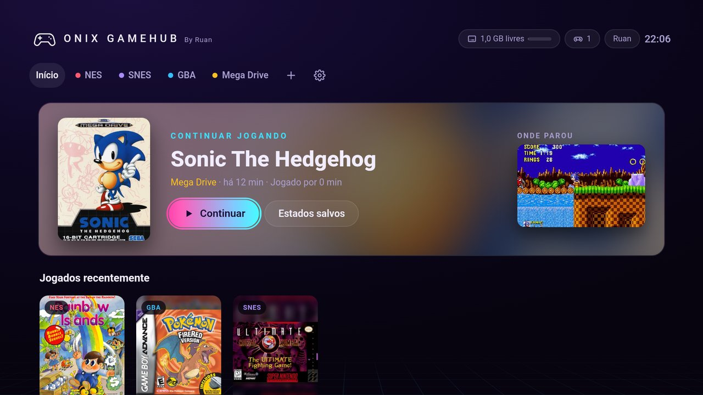
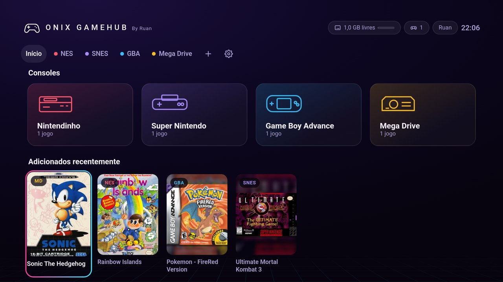
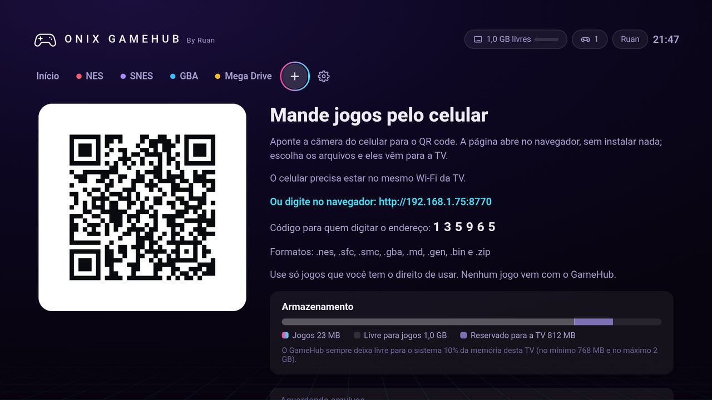
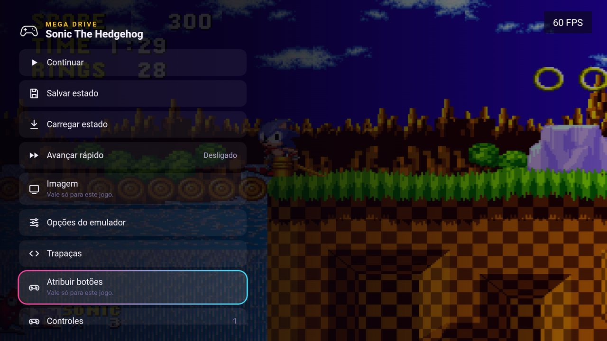
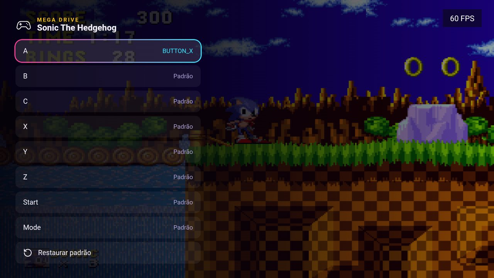
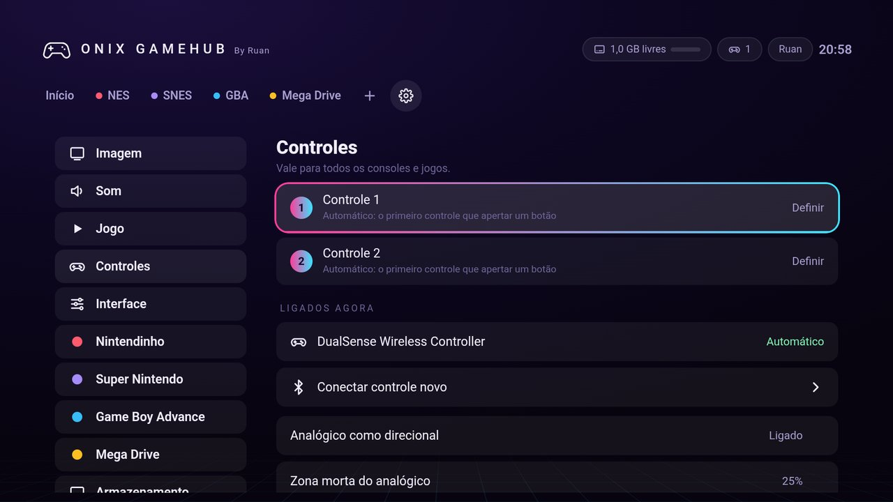
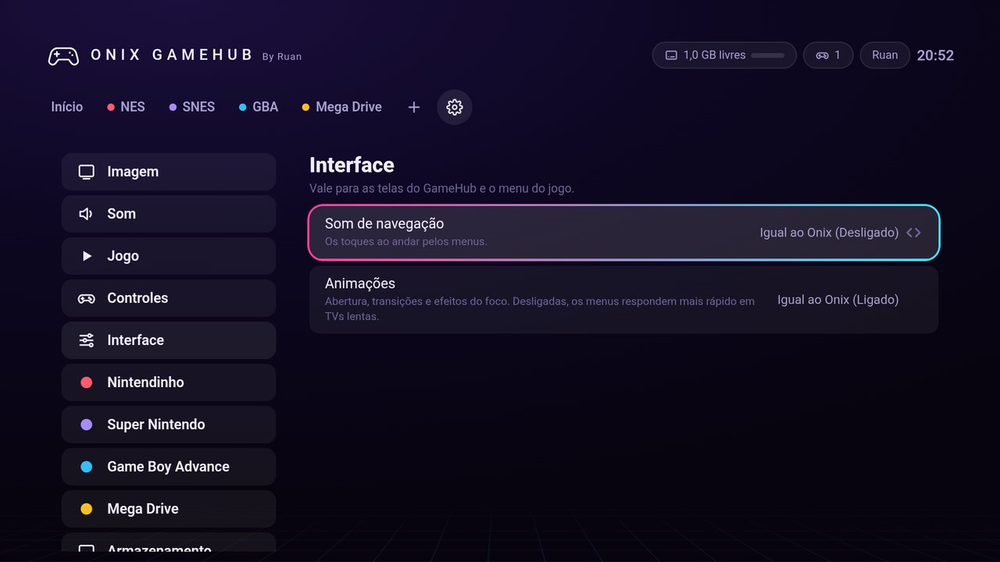

# Cobalt GameHub


Jogos clássicos de **Nintendinho (NES)**, **Super Nintendo**, **Game Boy Advance**, **Game Boy Color**, **Mega Drive**, **PlayStation**, **Atari** e **fliperama** num lugar só, no visual do [Onix](https://github.com/ruan2311/onix). Ele guarda o ponto onde você parou e tem estados salvos, avançar rápido, rebobinar, filtros de imagem, trapaças e botões configuráveis por jogo.

| Plataforma | Situação | Como os jogos entram |
|---|---|---|
| 📺 **Google TV e Android TV** | ✅ Disponível (1.5.0: 8 consoles) | Pelo celular, com um QR code |
| 📱 **Celular Android** (5.0 ou mais novo) | ✅ Disponível (1.7.0: até 14 consoles) | Escolhendo uma pasta do próprio celular |
| 🖥️ **PC (Windows)** | ✅ Disponível (1.4.0: com 7 consoles a mais) | Escolhendo a pasta dos jogos |
| 🍎 **iPhone e iPad** (iOS 16.4 ou mais novo) | ✅ Disponível | Web app instalável em [projectgems.github.io/gamehub/app](https://projectgems.github.io/gamehub/app/) |

O **mesmo APK** serve para a TV e para o celular: o GameHub percebe sozinho onde está e muda a interface.

> 🎮 **Novo na TV e no celular (1.7.0): Nintendo 64, Nintendo DS e PSP, e GameCube, Wii e PS2 em teste.** Os seis consoles que antes eram só do PC agora rodam dentro do GameHub no Android. O GameHub olha o processador, a memória e a placa de vídeo do aparelho, mostra só os consoles que ele aguenta e escolhe a resolução sozinho. Veja [Consoles 3D na TV e no celular](#-consoles-3d-na-tv-e-no-celular-170).

> 🇪🇸 *Nuevo en la TV y el celular (1.7.0): Nintendo 64, Nintendo DS y PSP, y GameCube, Wii y PS2 en prueba. GameHub analiza el procesador, la memoria y la tarjeta de video del aparato, muestra solo las consolas que aguanta y elige la resolución solo.*

> 💾 **Na TV (1.6.0): jogos direto do pendrive ou do HD.** Ligue um pendrive, HD externo ou cartão de memória na TV e abra **Adicionar jogos**: o GameHub mostra as pastas e põe os jogos na biblioteca **sem copiar nada para a memória da TV**. Funciona até nas TVs sem gerenciador de arquivos. Veja [Jogos do pendrive ou HD](#jogos-do-pendrive-ou-hd).

> 🇪🇸 *Nuevo en la TV (1.6.0): juegos directo desde una memoria USB o un disco externo, sin copiar nada a la memoria de la TV. Funciona incluso en las TV sin administrador de archivos.*

> 🎮 **1.5.1:** o PlayStation ganhou **L2 e R2** nos controles na tela do celular e no controle pelo celular (embaixo de L1 e R1 com o celular em pé, ao lado com ele deitado).

> 📺📱 **Novo na TV e no celular (1.5.0):** chegaram **Game Boy Color**, **PlayStation (PS1)**, **Atari 2600 e 7800** e **Fliperama** (jogos de arcade, como os do MAME, pelo FinalBurn Neo). Veja [Consoles novos da TV e do celular](#️-consoles-novos-da-tv-e-do-celular-150). O Armazenamento agora mostra o que ocupa espaço e limpa as sobras de envios que caíram.

> 🖥️ **Novo no PC (1.4.0):** além dos quatro consoles, o Cobalt GameHub para Windows abre **PlayStation, Game Boy Color, Nintendo 64, Nintendo DS, PSP, GameCube, Wii e PlayStation 2**, com resolução e controles por console. O RetroArch já vem dentro do `.zip` (sem internet). Veja [PC (Windows)](#️-pc-windows).

> ⚖️ **Nenhum jogo vem com o GameHub.** Use só jogos que você tem o direito de usar (por exemplo, cópias dos seus próprios cartuchos).

<p align="center">
  
  
</p>

## Sumário
- [📺 Google TV e Android TV](#-google-tv-e-android-tv)
- [📱 Celular Android](#-celular-android)
- [🕹️ Consoles novos da TV e do celular (1.5.0)](#️-consoles-novos-da-tv-e-do-celular-150)
- [🎮 Consoles 3D na TV e no celular (1.7.0)](#-consoles-3d-na-tv-e-no-celular-170)
- [🖥️ PC (Windows)](#️-pc-windows)
- [🍎 iPhone e iPad](#-iphone-e-ipad)
- [Funciona em todos](#funciona-em-todos)
- [Atualizar](#atualizar)
- [Formatos de jogo](#formatos-de-jogo)
- [Créditos e licenças](#créditos-e-licenças)

---

## 📺 Google TV e Android TV

### Instalar
1. No Onix, abra a aba **Jogos** e clique em **Instalar o GameHub**.
2. Na primeira vez, o Android pede para o **Onix** poder instalar apps: ative e volte. Depois, confirme em **Instalar**.
3. Pronto: o cartão **Cobalt GameHub** aparece na aba **Jogos**, com **Abrir o GameHub** e os consoles.

Sem o Onix: no app **Downloader**, use o link **`github.com/ruan2311/onix-gamehub/releases/latest/download/onix-gamehub.apk`**.

Com o Onix, o GameHub usa o perfil, o idioma, o Modo Infantil, os sons e as animações dele, e o "Continuar jogando" aparece também na aba **Jogos** do Onix. Nas TVs Samsung e LG não há GameHub: lá a aba Jogos do Onix vira um hub de jogos na nuvem.

✅ *Testado numa Philips Google TV (Android TV 14), com controle DualSense: 60 FPS no Super Nintendo.*

### Jogos do pendrive ou HD
1. Ligue o pendrive, o HD externo ou o cartão de memória na TV e abra **Adicionar jogos** (o **+** no topo). O cartão **Pendrive ou HD** mostra o nome, o formato e o espaço dele.
2. Na primeira vez, aperte **Permitir ler o pendrive**. A TV abre a tela **Acesso a todos os arquivos** (no Android 11 ou mais novo): ligue o **Cobalt GameHub** e volte. Do Android 6 ao 10, é só aceitar a pergunta. O GameHub só lê os jogos: nunca apaga nem muda nada no pendrive.
3. Aperte **Abrir o pendrive**, navegue pelas pastas com o controle e escolha **Adicionar os jogos desta pasta** (procura também nas subpastas) ou um jogo só.

Os jogos **rodam direto do pendrive**: na TV ficam só o nome, a capa e os saves, que são bem pequenos. Eles ganham a marca **USB** na capa. Se o pendrive não estiver ligado, o GameHub avisa qual ligar. Apagar um jogo do pendrive tira ele só da biblioteca; o arquivo continua lá.

**O que o pendrive precisa** (o GameHub mostra isso na TV, no botão **O que o pendrive precisa**):
- **Formato FAT32 ou exFAT.** Muitas TVs não leem o NTFS, que o Windows usa nos HDs. Se a TV não conseguir abrir o pendrive, o GameHub avisa. No FAT32, nenhum arquivo passa de 4 GB.
- **Armazenamento removível:** se a TV perguntar como usar o pendrive, escolha *removível* (ou *portátil*). A opção *armazenamento do dispositivo* apaga o pendrive.
- **HD externo com energia:** HD de notebook pode precisar de mais energia do que a porta USB da TV dá. Use um HD com fonte própria, um cabo em Y ou um hub USB com fonte.
- **Porta USB:** prefira a marcada como HDD ou USB 3.0 (azul). Se uma porta não reconhecer, tente a outra.
- **PlayStation:** o `.cue` e os `.bin` dele na mesma pasta (ou `.chd` e `.pbp`).
- Não tire o pendrive durante o jogo.

### Mandar jogos pelo celular
1. No GameHub, abra **Adicionar jogos** (o **+** no topo).
2. Aponte a câmera do celular para o **QR code**. A página abre no navegador, sem instalar nada. O celular precisa estar **no mesmo Wi-Fi** da TV.
3. Toque em **Escolher arquivos** e escolha um ou vários jogos. A TV mostra o progresso, e a capa e o nome certos aparecem em alguns segundos (precisa de internet).

Sem câmera? Digite no navegador do celular o endereço que aparece na TV (por exemplo `http://192.168.1.75:8770`) e, quando a página pedir, o **código de 6 números** que está logo embaixo. Cinco códigos errados trocam o código, e a TV mostra o novo.

O GameHub nunca enche a memória da TV: ele sempre deixa livre para o sistema 10% da memória (no mínimo 768 MB e no máximo 2 GB), e o resto aparece como **livre para jogos** no topo.

<p align="center">
  
</p>

### Controle
Use um **controle Bluetooth** (Xbox, PlayStation, 8BitDo…) ou use seu **celular como controle**:
- **Android:** use o aplicativo [Onix Controle](https://github.com/ruan2311/onix#onix-controle-para-celular) conectado via Wi-Fi. Ainda não tem? Na TV, toque em **Celular como controle → Baixar o Onix Controle** e aponte a câmera do celular para o QR code.
- **iPhone:** aponte a câmera para o QR Code em **Celular como controle** no GameHub da TV. A página abre direto no Safari no Wi-Fi local, pode ser salva na Tela de Início como app de tela cheia, e permite navegar pelos menus da TV e jogar em qualquer console com resposta instantânea.
Controle Bluetooth e celular podem jogar juntos: cada um vira um jogador (quem já estava ligado é o Jogador 1, o outro é o Jogador 2).
O controle remoto da TV também joga, mas só com poucos botões.

---

## 📱 Celular Android

> 📱 Funciona no Android 5.0 ou mais novo.

### Instalar
1. No celular, baixe o [`onix-gamehub.apk`](https://github.com/ruan2311/onix-gamehub/releases/latest/download/onix-gamehub.apk) (o mesmo da TV).
2. Abra o arquivo e confirme em **Instalar**. Se o Android pedir, deixe o navegador ou o gerenciador de arquivos instalar apps.

### Adicionar jogos
Em **Adicionar jogos**, toque em **Escolher pasta** e escolha a pasta onde estão os seus jogos. O GameHub procura também nas subpastas e copia os de todos os consoles dele, até os discos de PlayStation (`.cue` com os `.bin`) e os `.zip` de fliperama.

### Jogar
- Os menus ficam **em pé**. O jogo pode ser jogado **em pé ou deitado**.
- Cada console tem os **próprios controles na tela**, no visual do Onix. Com um controle Bluetooth conectado, eles somem.
- **Editor dos controles:** cada botão se arrasta sozinho (o direcional, A, B, X, Y, L, R, SELECT, START, menu e avançar). Toque num botão para mudar o tamanho e a transparência só dele; sem nenhum escolhido, a mudança vale para todos. **Em pé e deitado são dois layouts separados** (desde a 1.7.0, como no Onix Controle): a posição, o tamanho e a transparência de um não mudam o outro, e **Restaurar** volta só o que está na tela. No editor, **Usar analógico** troca a cruz por um analógico (e **Usar cruz** volta). Fica no menu do jogo e em **Configurações → Controles**.
- A tela cheia só liga durante o jogo.

---

## 🕹️ Consoles novos da TV e do celular (1.5.0)

Valem para a TV e para o celular Android (o mesmo APK).

### Game Boy Color
- **Formatos:** `.gbc` e `.gb` (também dentro de `.zip`). Usa o mesmo emulador do GBA (mGBA).

### PlayStation (PS1)
- **Formatos:** `.chd`, `.pbp` ou `.cue` com os `.bin` do disco, até 1,2 GB por arquivo. Pode mandar o `.cue` e os `.bin` juntos, em qualquer ordem: o disco espera até chegarem todos os arquivos e só então entra na biblioteca. Um disco que fica pela metade sai sozinho depois de um dia.
- **BIOS:** não precisa; o PCSX ReARMed traz uma livre.
- **Controle:** △ ○ ✕ □, L1/R1 e L2/R2 (no controle na tela também: L2 e R2 ficam embaixo de L1 e R1 com o celular em pé e ao lado com ele deitado).
- **Espaço:** um disco tem de 300 a 700 MB. Em TVs com pouca memória, cabe um ou dois.

### Atari 2600 e 7800
- **Formatos:** `.a26` (2600, pelo Stella 2014) e `.a78` (7800, pelo ProSystem), na mesma aba **Atari**.

### Fliperama
- **Formatos:** o `.zip` do jogo com o **nome original** do romset, como `sf2.zip` ou `mslug.zip` (não descompacte nem renomeie). Usa o **FinalBurn Neo**, com mais de 8 mil jogos (Capcom, Neo Geo, Konami, Sega…).
- **Clones e Neo Geo:** um clone precisa também do `.zip` do jogo principal, e os de Neo Geo precisam do `neogeo.zip` (a BIOS). Mande os dois: a BIOS fica guardada sem aparecer na biblioteca.
- **Controle:** botões 1 a 6, **FICHA** (o Select, para pôr crédito) e Start. Jogos de tela em pé, como Galaga e Pac-Man, aparecem em pé.

### Armazenamento
Em **Configurações → Armazenamento**, o GameHub mostra quanto ocupam os jogos, os saves e estados, as capas e as **sobras de envios** (um envio que caiu no meio, um disco de PS1 que ficou esperando). As sobras saem sozinhas ao abrir o GameHub e depois de apagar um jogo, e o botão **Limpar sobras** apaga na hora. O espaço livre do topo atualiza logo depois de apagar um jogo.

---

## 🎮 Consoles 3D na TV e no celular (1.7.0)

Os mesmos seis consoles do PC, rodando dentro do GameHub (sem RetroArch à parte). Valem para a TV e para o celular Android (o mesmo APK).

| Console | Formatos | Precisa de |
|---|---|---|
| **Nintendo 64** (ParaLLEl N64) | `.z64`, `.n64`, `.v64` | qualquer aparelho |
| **Nintendo DS** (melonDS DS) | `.nds` | qualquer aparelho |
| **PSP** (PPSSPP) | `.iso`, `.cso` | qualquer aparelho |
| **GameCube** 🧪 (Dolphin) | `.iso`, `.gcm`, `.gcz`, `.ciso`, `.rvz`, `.wia` | 64 bits, processador intermediário (como o Cortex-A76) e 4 GB |
| **Wii** 🧪 (Dolphin) | `.iso`, `.wbfs`, `.rvz`, `.wia`, `.gcz` | 64 bits, processador intermediário e 4 GB |
| **PlayStation 2** 🧪 (PCSX2) | `.iso`, `.chd` | 64 bits, processador forte (Cortex-X) e 6 GB |

🧪 = em teste: pode ficar lento ou não abrir alguns jogos.

- **O GameHub vê o aparelho:** em **Configurações → Sobre → Este aparelho** aparecem o processador, a memória, a placa de vídeo e, para cada console, se roda bem, se pode ficar lento ou se fica abaixo do mínimo. Os consoles abaixo do mínimo **nem aparecem**. A resolução é escolhida sozinha pela força do aparelho (dá para mudar em **Opções do emulador**).
- **Arquivos do sistema:** na primeira vez que um jogo de PSP, GameCube ou Wii abre, o GameHub baixa os arquivos que o emulador precisa (os mesmos do PC, conferidos). Precisa de internet só nessa vez.
- **BIOS do PS2:** é a do seu próprio console. Mande o arquivo da BIOS pelo **Adicionar jogos**, como um jogo: o GameHub reconhece e guarda no lugar certo.
- **Nintendo DS:** toque na tela de baixo para usar a caneta.
- **Wii:** dois controles. O botão **⇄** na tela (ou **menu do jogo → Controle do Wii**) troca entre **Wii Remote + Nunchuk** (com A, B, 1, 2, C, Z, Sacudir e o analógico do Nunchuk; tocar na tela mira, como apontar o controle) e **Classic Controller** (A, B, X, Y, L, R, ZL, ZR). A escolha fica guardada em cada jogo.
- **Na TV:** a maioria das TVs tem processador fraco e é de 32 bits, então mostra só N64, DS e PSP, e os jogos mais pesados podem ficar lentos.

---

## 🖥️ PC (Windows)

> 🖥️ Windows 10 ou 11, 64 bits.

As mesmas telas da TV, com **mais animações** (páginas que deslizam, cartões que sobem com o mouse, brilho nas capas e uma aurora lenta no fundo) e os mesmos 4 emuladores, rodando dentro do app. Só no PC, tem também o **PlayStation (PS1)**, o **Game Boy Color** e, pelo RetroArch, **Nintendo 64, Nintendo DS, PSP, GameCube, Wii e PlayStation 2**.

### Instalar
1. Baixe o `Cobalt-GameHub-win64.zip` nas [Releases](https://github.com/ruan2311/cobalt-gamehub/releases) (o arquivo "Cobalt GameHub para PC").
2. Extraia a pasta **inteira** (mantenha a `motor-retroarch-1` junto do `.exe`) e abra o **Cobalt GameHub.exe** (ou **Onix GameHub.exe** nas versões anteriores).
3. Se o Windows mostrar *"O Windows protegeu o computador"*, clique em **Mais informações → Executar assim mesmo** (o app ainda não tem assinatura digital).

### Adicionar jogos
Em **Adicionar jogos** (o **+** no topo), clique em **Escolher pasta**. O GameHub procura também nas subpastas, e a pasta fica guardada: a cada abertura, ele traz os jogos novos que aparecerem nela. Os arquivos **continuam onde estão** (só os de `.zip` são copiados para a pasta do GameHub). Também dá para **Escolher arquivos** soltos.

Apagar um jogo no GameHub tira ele da biblioteca, com os saves e os estados salvos, mas o arquivo continua na sua pasta.

### PlayStation (PS1, só no PC)
- **Formatos:** `.cue` (com os `.bin` do disco na mesma pasta), `.chd` e `.pbp`. O disco não é copiado nem carregado inteiro na memória: o GameHub lê só o pedaço que o jogo precisa.
- **BIOS:** não precisa. O emulador traz uma BIOS livre que abre a maioria dos jogos. Para mais compatibilidade, dá para pôr a BIOS do seu próprio console (por exemplo `scph1001.bin`) na pasta `system` dos dados do GameHub.
- **Controle:** ✕, ○, □ e △ ficam nos botões de baixo, da direita, da esquerda e de cima do controle; L1, R1, L2 e R2 nos gatilhos. No teclado: Z = ✕, X = ○, A = □, S = △, Q/W = L1/R1, Enter = Start. Como L2 e R2 são do jogo, **Avançar rápido** fica no menu.
- O cartão de memória é salvo junto com os saves, e os estados salvos funcionam como nos outros consoles.
- Ainda não: jogos de vários discos (`.m3u`) e o controle analógico (DualShock).

### Nintendo 64, DS, PSP, GameCube, Wii e PS2 (só no PC)
- Abrem pelo **RetroArch**, que já vem dentro do `.zip` (pasta `motor-retroarch-1`): nada é baixado, funciona sem internet. O jogo abre em tela cheia; **Tab** (teclado) ou **Select + Start** (controle) abre o menu do emulador, e **Esc** volta ao GameHub.
- **Formatos:** N64 `.z64`, `.n64`, `.v64`; DS `.nds`; PSP `.iso`, `.cso`; GameCube `.iso`, `.gcm`, `.gcz`, `.ciso`, `.rvz`, `.wia`; Wii `.iso`, `.wbfs`, `.rvz`, `.wia`, `.gcz`; PS2 `.iso`, `.chd`. O GameHub lê o começo do arquivo para saber de qual console é um `.iso`.
- **Configurações** (em Configurações, na página de cada console, ou na tela do jogo): resolução, renderizador (OpenGL ou Vulkan) e widescreen. No **Automático**, o GameHub olha a placa de vídeo, o processador e a memória do PC e escolhe sozinho.
- **Controles:** escolha o botão do console (com os nomes dele, como o B do Wii) e aperte a tecla do teclado ou o botão do controle (padrão Xbox) que vai fazer ele.
- **BIOS:** só o PS2 precisa, a do seu próprio console. O GameHub abre a pasta certa e explica.

### Controles e teclado
- Controles de Xbox, PlayStation, 8BitDo… funcionam direto: aperte um botão para o GameHub ver o controle. Nos menus, A confirma, B volta e LB/RB trocam de aba.
- **Teclado:** setas = direcional, **X** = A, **Z** = B, **S** = X, **A** = Y, **Q/W** = L/R, **Enter** = Start, **Shift direito** = Select. Segure **Tab** para acelerar e **Backspace** para rebobinar.
- **Esc** (ou **Select + Start** no controle) abre o menu do jogo. **F11** ou **Alt + Enter**: tela cheia.
- Dá para trocar qualquer tecla ou botão em **Configurações → Controles → Trocar botões**, como na TV.

### Configurações gráficas (só no PC)
Em **Configurações → Imagem** (ou por console, ou por jogo):

- **Filtros:** além de Nítido, Pixel puro, Suave, CRT e LCD, o PC tem **CRT curvado** (a tela de tubo, com a curvatura e os cantos arredondados) e **Linhas de varredura**.
- **Brilho**, **Cores (saturação)**, até preto e branco.
- **Força das linhas** e **Curvatura da tela** dos filtros CRT, e **Bordas escurecidas**.
- **Mistura de quadros:** some a piscada de sombras e transparências (bom no Game Boy Advance).
- **Fundo ao redor do jogo:** *Ambiente* (a própria imagem do jogo, borrada, preenche as laterais), *Vidro do GameHub* ou *Preto*.
- **Tela cheia** ao abrir.

### Onde ficam os dados
Em `%APPDATA%\Onix GameHub`: saves, estados salvos, capas e configurações. Se algo der errado, o arquivo `gamehub.log` dessa pasta conta o que aconteceu.

### Para quem programa
O app é [Electron](https://www.electronjs.org/) e fica em [`pc/`](pc): as telas são as mesmas da TV (`assets/`), e o motor de jogo da TV (`jni/retro.c`) virou `pc/core/web.c`, compilado com os 4 núcleos para WebAssembly pelo [Emscripten](https://emscripten.org/).

```
bash pc/cores.sh              # núcleos para WebAssembly (precisa do Emscripten em ~/emsdk)
cd pc && npm install && npm start
node pc/build-win.js          # pc/dist/Onix-GameHub-win64.zip
```

---

## 🍎 iPhone e iPad

O GameHub roda como um **site instalável**: grátis, sem loja e sem conta da Apple. Abre e joga sem internet depois da primeira vez.

### Instalar

1. Abra [projectgems.github.io/gamehub/app](https://projectgems.github.io/gamehub/app/) no **Safari**.
2. Toque em **Compartilhar** e depois em **Adicionar à Tela de Início**.
3. Abra pelo **ícone novo**. Faça isso antes de adicionar jogos: o Safari e o ícone guardam os dados separados.

### Adicionar jogos

Em **Adicionar jogos**, toque em **Escolher arquivos**. O iPhone não deixa um site escolher pastas; escolha os arquivos (pode marcar vários) ou um `.zip`. O GameHub guarda uma cópia dentro dele.

### Saves e backup

Jogos, saves e estados ficam só no aparelho. Em **Configurações → Armazenamento**, **Exportar saves** gera um `.zip` com saves, estados e configurações (sem os jogos) para guardar no app Arquivos ou no iCloud, e **Importar saves** traz ele de volta. Sem o ícone instalado, o Safari pode apagar os dados de sites sem uso.

### Controles

Os controles na tela contam com edição independente para as orientações **vertical e horizontal**: personalize o tamanho, transparência e posição dos botões em cada modo separadamente. Controles Bluetooth funcionam perfeitamente (Xbox, PlayStation, 8BitDo): pareie em **Ajustes → Bluetooth**. Com um conectado, os da tela somem; um toque na imagem abre o menu.

### Para quem programa

Fica em `gamehub/ios/` e reaproveita as telas (`assets/`), o jogo (`pc/web/game.js`) e os núcleos em WebAssembly (`pc/build/cores`). `bash gamehub/ios/build.sh` gera o site em `~/gems/gamehub/app`; depois é só publicar o site. Os dados ficam no IndexedDB (veja o começo de `ios/shell.js`).

## Funciona em todos

### Continuar jogando
Ao sair, o GameHub guarda o ponto exato. **Continuar** volta dali, com a imagem de onde você parou. Segure **R2** para acelerar e **L2** para rebobinar (ligue **Rebobinar** em **Configurações → Jogo**).

### Menu do jogo
Aperte **Voltar** (ou **Select + Start** no controle) durante o jogo:

- **Salvar estado** e **Carregar estado**: quatro espaços por jogo, cada um com a imagem do momento.
- **Avançar rápido**, **Imagem** (filtro **Nítido**, **CRT** ou **LCD**, tamanho e proporção) e **Opções do emulador**, só para aquele jogo.
- **Trapaças**: códigos Game Genie, Action Replay, GameShark…
- **Atribuir botões**: OK num botão do console e aperte, no controle, o botão que vai fazer aquilo. Vale só para aquele jogo.
- **Reiniciar o jogo** e **Sair do jogo**.

<p align="center">
  
  
</p>

### Configurações
Na engrenagem do topo:

- **Imagem, Som e Jogo**: valem para todos os consoles. **Mostrar FPS**, **Atraso do som** (se o som estalar, teste 96 ms), **Run-ahead** (menos atraso nos botões, mas mais peso no aparelho), velocidade do avançar e do turbo.
- **Controles → Controle 1 e Controle 2**: clique em **Definir** e aperte um botão no controle escolhido. Também dá para **trocar botões** de cada console.
- **Interface**: **Som de navegação** e **Animações**: *Igual ao Onix* (padrão), *Ligado* ou *Desligado*.
- **Um item por console** (Nintendinho, Super Nintendo, Game Boy Advance, Game Boy Color, Mega Drive, PlayStation, Atari e Fliperama): imagem, turbo e as opções do emulador daquele console.
- **Armazenamento**: quanto ocupam os jogos, os saves, as capas e as sobras, quanto ainda cabe e o botão **Limpar sobras**.

<p align="center">
  
  
</p>

### Perfis e Modo Infantil (com o Onix)
- Cada perfil do Onix tem os **próprios saves e estados**. Os arquivos dos jogos são os mesmos para todos.
- No perfil **infantil**, só aparecem os jogos marcados com **Liberar no Modo Infantil** (OK no jogo, num perfil de adulto). Não dá para adicionar, apagar nem instalar ou desinstalar o GameHub.

---

## Atualizar
As versões saem nas [Releases deste repositório](https://github.com/ruan2311/onix-gamehub/releases), com a tag `gamehub-vX.Y.Z`.

- **TV:** o cartão do GameHub na aba **Jogos** do Onix mostra **Atualizar**. Dentro do GameHub, também em **Configurações → Sobre → Procurar atualizações**.
- **Celular:** a versão nova baixa sozinha, e o GameHub pergunta se pode instalar.
- **Desinstalar (TV):** no mesmo cartão da aba **Jogos**. Os jogos e os saves saem junto com o app.

## Formatos de jogo
`.nes`, `.sfc`, `.smc`, `.gba`, `.gbc`, `.gb`, `.md`, `.gen`, `.bin` e `.zip` (com o jogo dentro), até 64 MB por arquivo. PlayStation: `.cue` + `.bin`, `.chd` e `.pbp`. Atari: `.a26` e `.a78`. Fliperama: o `.zip` com o nome do romset (como `sf2.zip`). Desde a 1.7.0, também N64, DS, PSP, GameCube, Wii e PS2 (veja [Consoles 3D](#-consoles-3d-na-tv-e-no-celular-170)). Arquivos que não são jogo, como uma foto, são recusados com aviso.

## Créditos e licenças
Emuladores de código aberto do projeto [libretro](https://www.libretro.com/): **FCEUmm** (NES, GPL-2.0), **Snes9x** (SNES, licença não comercial), **mGBA** (GBA, MPL-2.0) e **Genesis Plus GX** (Mega Drive, licença não comercial), **PCSX ReARMed** (PlayStation, GPL-2.0), **Stella 2014** (Atari 2600, GPL-2.0), **ProSystem** (Atari 7800, GPL-2.0), **FinalBurn Neo** (fliperama, licença não comercial) e, no PC, o **RetroArch** com **Mupen64Plus-Next** (N64), **melonDS DS** (DS), **PPSSPP** (PSP), **Dolphin** (GameCube e Wii) e **PCSX2/LRPS2** (PS2), todos GPL. Na TV e no celular: **ParaLLEl N64** (GPL-2.0), **melonDS DS** (GPL-3.0), **PPSSPP** (GPL-2.0), **Dolphin** (GPL-2.0) e **PCSX2** (GPL-3.0). Nomes dos jogos: libretro-database (No-Intro, CC BY-SA 4.0); capas: libretro-thumbnails. As licenças completas estão em **Configurações → Sobre** e em [`assets/licenses`](assets/licenses).

O código do GameHub está sob a [GPL-3.0](LICENSE). O GameHub é gratuito e nunca terá anúncios.

---

🇪🇸 **Cobalt GameHub:** juegos clásicos de NES, Super Nintendo, Game Boy Advance, Game Boy Color, Mega Drive, PlayStation, Atari y arcade con el estilo de Onix. **Novedades de la 1.5.0 (TV y celular Android):** Game Boy Color, PlayStation (.chd, .pbp o .cue con los .bin), Atari 2600 y 7800 y Arcade con FinalBurn Neo (el .zip con el nombre original del juego, como sf2.zip); el Almacenamiento muestra qué ocupa espacio y limpia los restos de envíos; en los controles táctiles se puede cambiar la cruceta por un analógico. En **Google TV y Android TV** los juegos llegan desde el celular por código QR; en el **celular Android** se eligen desde una carpeta, con controles táctiles editables; la versión para **PC (Windows)** permite jugar desde una carpeta con teclado o control y ajustes de imagen (CRT curvo, brillo, colores, fondo ambiente), además de **PlayStation (PS1)**, **Game Boy Color** y, por RetroArch incluido (sin internet), **Nintendo 64, DS, PSP, GameCube, Wii y PS2** solo en PC, con resolución automática según la PC y controles por teclado o control; y en **iPhone y iPad** funciona como web app instalable desde Safari, con edición de controles independiente en vertical y horizontal. Ningún juego viene incluido. **Novedades de la 1.5.1:** PlayStation con **L2 y R2** en los controles táctiles del celular y en el control por celular. **Novedades de la 1.7.0 (TV y celular Android):** Nintendo 64, Nintendo DS y PSP, y GameCube, Wii y PS2 en prueba (solo en aparatos de 64 bits); GameHub analiza el aparato, muestra solo las consolas que aguanta y elige la resolución; en Wii, botón ⇄ para cambiar entre Wii Remote + Nunchuk y Classic Controller; los controles táctiles tienen diseños separados en vertical y horizontal.
