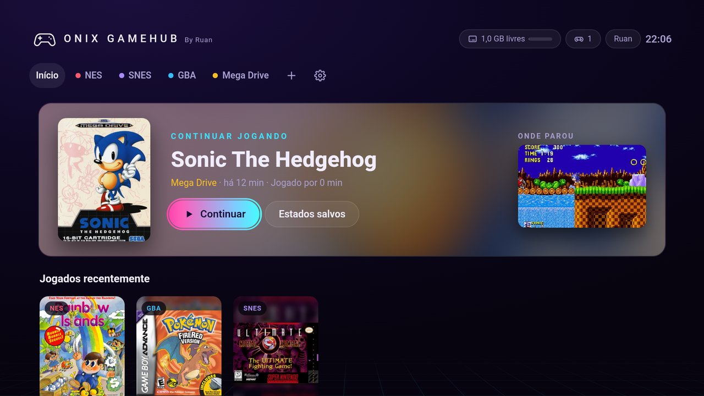
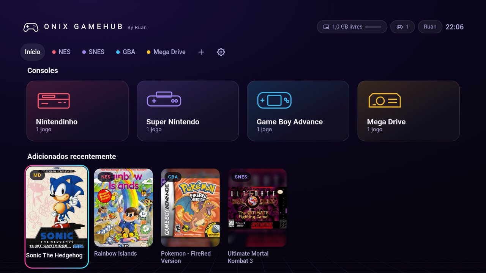
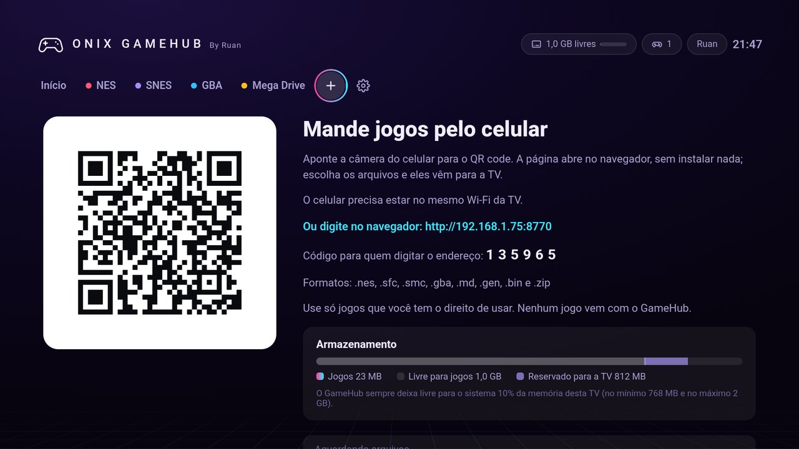
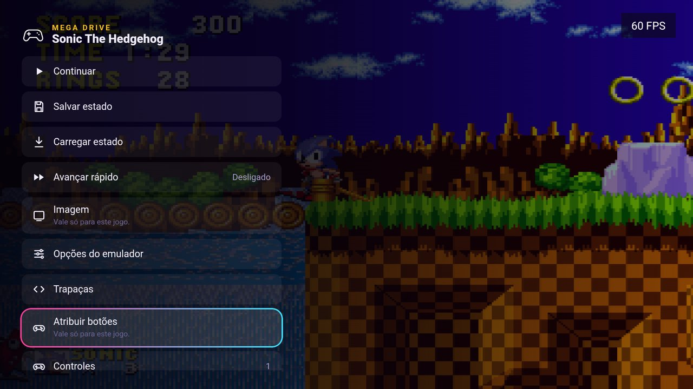
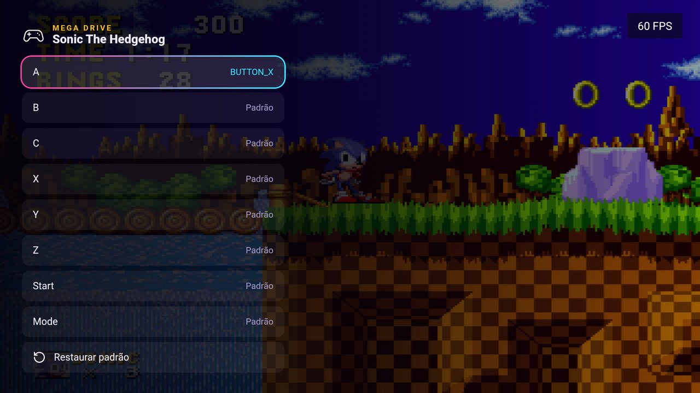
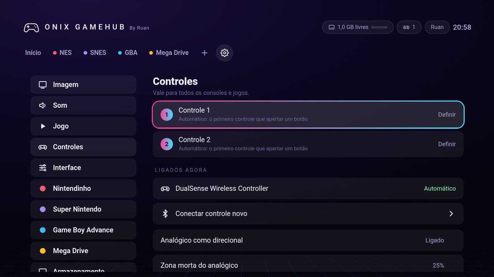
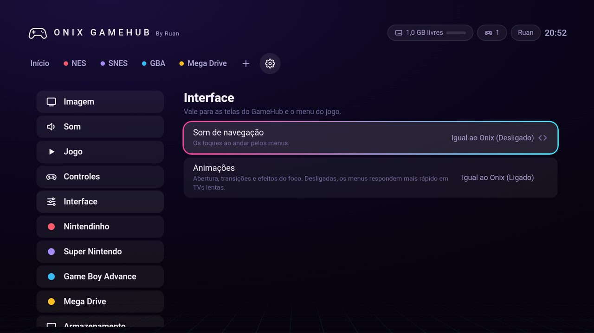

# Onix GameHub


Jogos clássicos de **Nintendinho (NES)**, **Super Nintendo**, **Game Boy Advance** e **Mega Drive** num lugar só, no visual do [Onix](https://github.com/ruan2311/onix). Ele guarda o ponto onde você parou e tem estados salvos, avançar rápido, rebobinar, filtros de imagem, trapaças e botões configuráveis por jogo.

| Plataforma | Situação | Como os jogos entram |
|---|---|---|
| 📺 **Google TV e Android TV** | ✅ Disponível | Pelo celular, com um QR code |
| 📱 **Celular Android** (5.0 ou mais novo) | 🧪 Experimental | Escolhendo uma pasta do próprio celular |
| 🖥️ **PC (Windows)** | 🧪 Em teste | Escolhendo a pasta dos jogos |

O **mesmo APK** serve para a TV e para o celular: o GameHub percebe sozinho onde está e muda a interface.

> ⚖️ **Nenhum jogo vem com o GameHub.** Use só jogos que você tem o direito de usar (por exemplo, cópias dos seus próprios cartuchos).

> 🧪 **Experimental:** pode apresentar falhas. Se algo não funcionar, [abra uma issue](https://github.com/ruan2311/onix/issues).

<p align="center">
  
  
</p>

## Sumário
- [📺 Google TV e Android TV](#-google-tv-e-android-tv)
- [📱 Celular Android](#-celular-android)
- [🖥️ PC (Windows)](#️-pc-windows)
- [Funciona em todos](#funciona-em-todos)
- [Atualizar](#atualizar)
- [Formatos de jogo](#formatos-de-jogo)
- [Créditos e licenças](#créditos-e-licenças)

---

## 📺 Google TV e Android TV

### Instalar
1. No Onix, abra a aba **Jogos** e clique em **Instalar o GameHub**.
2. Na primeira vez, o Android pede para o **Onix** poder instalar apps: ative e volte. Depois, confirme em **Instalar**.
3. Pronto: o cartão **Onix GameHub** aparece na aba **Jogos**, com **Abrir o GameHub** e os quatro consoles.

Sem o Onix: no app **Downloader**, use o link **`github.com/ruan2311/onix-gamehub/releases/latest/download/onix-gamehub.apk`**.

Com o Onix, o GameHub usa o perfil, o idioma, o Modo Infantil, os sons e as animações dele, e o "Continuar jogando" aparece também na aba **Jogos** do Onix. Nas TVs Samsung e LG não há GameHub: lá a aba Jogos do Onix vira um hub de jogos na nuvem.

✅ *Testado numa Philips Google TV (Android TV 14), com controle DualSense: 60 FPS no Super Nintendo.*

### Mandar jogos pelo celular
1. No GameHub, abra **Adicionar jogos** (o **+** no topo).
2. Aponte a câmera do celular para o **QR code**. A página abre no navegador, sem instalar nada. O celular precisa estar **no mesmo Wi-Fi** da TV.
3. Toque em **Escolher arquivos** e escolha um ou vários jogos. A TV mostra o progresso, e a capa e o nome certos aparecem em alguns segundos (precisa de internet).

Sem câmera? Digite no navegador do celular o endereço que aparece na TV (por exemplo `http://192.168.1.75:8770`) e, quando a página pedir, o **código de 6 números** que está logo embaixo. Cinco códigos errados trocam o código, e a TV mostra o novo.

O GameHub nunca enche a memória da TV: ele sempre deixa livre para o sistema 10% da memória (no mínimo 768 MB e no máximo 2 GB), e o resto aparece como **livre para jogos** no topo.

<p align="center">
  
</p>

### Controle
Use um **controle Bluetooth** (Xbox, PlayStation, 8BitDo…). Para parear, clique em **Sem controle** no topo do GameHub ou vá em **Configurações → Controles → Conectar controle novo**. O controle remoto da TV também joga, mas só com poucos botões.

---

## 📱 Celular Android

> 🧪 **Experimental.** Funciona no Android 5.0 ou mais novo.

### Instalar
1. No celular, baixe o [`onix-gamehub.apk`](https://github.com/ruan2311/onix-gamehub/releases/latest/download/onix-gamehub.apk) (o mesmo da TV).
2. Abra o arquivo e confirme em **Instalar**. Se o Android pedir, deixe o navegador ou o gerenciador de arquivos instalar apps.

### Adicionar jogos
Em **Adicionar jogos**, toque em **Escolher pasta** e escolha a pasta onde estão os seus jogos. O GameHub procura também nas subpastas e copia os de NES, Super Nintendo, Game Boy Advance e Mega Drive.

### Jogar
- Os menus ficam **em pé**. O jogo pode ser jogado **em pé ou deitado**.
- Cada console tem os **próprios controles na tela**, no visual do Onix. Com um controle Bluetooth conectado, eles somem.
- **Editor dos controles:** arraste os botões e mude o tamanho e a transparência. As posições ficam guardadas separadas para em pé e deitado. Fica no menu do jogo e em **Configurações → Controles**.
- A tela cheia só liga durante o jogo.

---

## 🖥️ PC (Windows)

> 🧪 **Em teste.** Windows 10 ou 11, 64 bits. Pode apresentar falhas.

As mesmas telas da TV, com **mais animações** (páginas que deslizam, cartões que sobem com o mouse, brilho nas capas e uma aurora lenta no fundo) e os mesmos 4 emuladores, rodando dentro do app.

### Instalar
1. Baixe o `Onix-GameHub-win64.zip` nas [Releases](https://github.com/ruan2311/onix-gamehub/releases) (o arquivo "Onix GameHub para PC").
2. Extraia a pasta e abra o **Onix GameHub.exe**.
3. Se o Windows mostrar *"O Windows protegeu o computador"*, clique em **Mais informações → Executar assim mesmo** (o app ainda não tem assinatura digital).

### Adicionar jogos
Em **Adicionar jogos** (o **+** no topo), clique em **Escolher pasta**. O GameHub procura também nas subpastas, e a pasta fica guardada: a cada abertura, ele traz os jogos novos que aparecerem nela. Os arquivos **continuam onde estão** (só os de `.zip` são copiados para a pasta do GameHub). Também dá para **Escolher arquivos** soltos.

Apagar um jogo no GameHub tira ele da biblioteca, com os saves e os estados salvos, mas o arquivo continua na sua pasta.

### Controles e teclado
- Controles de Xbox, PlayStation, 8BitDo… funcionam direto: aperte um botão para o GameHub ver o controle. Nos menus, A confirma, B volta e LB/RB trocam de aba.
- **Teclado:** setas = direcional, **X** = A, **Z** = B, **S** = X, **A** = Y, **Q/W** = L/R, **Enter** = Start, **Shift direito** = Select. Segure **Tab** para acelerar e **Backspace** para rebobinar.
- **Esc** (ou **Select + Start** no controle) abre o menu do jogo. **F11** ou **Alt + Enter**: tela cheia.
- Dá para trocar qualquer tecla ou botão em **Configurações → Controles → Trocar botões**, como na TV.

### Configurações gráficas (só no PC)
Em **Configurações → Imagem** (ou por console, ou por jogo):

- **Filtros:** além de Nítido, Pixel puro, Suave, CRT e LCD, o PC tem **CRT curvado** (a tela de tubo, com a curvatura e os cantos arredondados) e **Linhas de varredura**.
- **Brilho**, **Cores (saturação)**, até preto e branco.
- **Força das linhas** e **Curvatura da tela** dos filtros CRT, e **Bordas escurecidas**.
- **Mistura de quadros:** some a piscada de sombras e transparências (bom no Game Boy Advance).
- **Fundo ao redor do jogo:** *Ambiente* (a própria imagem do jogo, borrada, preenche as laterais), *Vidro do GameHub* ou *Preto*.
- **Tela cheia** ao abrir.

### Onde ficam os dados
Em `%APPDATA%\Onix GameHub`: saves, estados salvos, capas e configurações. Se algo der errado, o arquivo `gamehub.log` dessa pasta conta o que aconteceu.

### Para quem programa
O app é [Electron](https://www.electronjs.org/) e fica em [`pc/`](pc): as telas são as mesmas da TV (`assets/`), e o motor de jogo da TV (`jni/retro.c`) virou `pc/core/web.c`, compilado com os 4 núcleos para WebAssembly pelo [Emscripten](https://emscripten.org/).

```
bash pc/cores.sh              # núcleos para WebAssembly (precisa do Emscripten em ~/emsdk)
cd pc && npm install && npm start
node pc/build-win.js          # pc/dist/Onix-GameHub-win64.zip
```

---

## Funciona em todos

### Continuar jogando
Ao sair, o GameHub guarda o ponto exato. **Continuar** volta dali, com a imagem de onde você parou. Segure **R2** para acelerar e **L2** para rebobinar (ligue **Rebobinar** em **Configurações → Jogo**).

### Menu do jogo
Aperte **Voltar** (ou **Select + Start** no controle) durante o jogo:

- **Salvar estado** e **Carregar estado**: quatro espaços por jogo, cada um com a imagem do momento.
- **Avançar rápido**, **Imagem** (filtro **Nítido**, **CRT** ou **LCD**, tamanho e proporção) e **Opções do emulador**, só para aquele jogo.
- **Trapaças**: códigos Game Genie, Action Replay, GameShark…
- **Atribuir botões**: OK num botão do console e aperte, no controle, o botão que vai fazer aquilo. Vale só para aquele jogo.
- **Reiniciar o jogo** e **Sair do jogo**.

<p align="center">
  
  
</p>

### Configurações
Na engrenagem do topo:

- **Imagem, Som e Jogo**: valem para todos os consoles. **Mostrar FPS**, **Atraso do som** (se o som estalar, teste 96 ms), **Run-ahead** (menos atraso nos botões, mas mais peso no aparelho), velocidade do avançar e do turbo.
- **Controles → Controle 1 e Controle 2**: clique em **Definir** e aperte um botão no controle escolhido. Também dá para **trocar botões** de cada console.
- **Interface**: **Som de navegação** e **Animações**: *Igual ao Onix* (padrão), *Ligado* ou *Desligado*.
- **Nintendinho, Super Nintendo, Game Boy Advance e Mega Drive**: imagem, turbo e as opções do emulador daquele console.
- **Armazenamento**: quanto os jogos ocupam e quanto ainda cabe.

<p align="center">
  
  
</p>

### Perfis e Modo Infantil (com o Onix)
- Cada perfil do Onix tem os **próprios saves e estados**. Os arquivos dos jogos são os mesmos para todos.
- No perfil **infantil**, só aparecem os jogos marcados com **Liberar no Modo Infantil** (OK no jogo, num perfil de adulto). Não dá para adicionar, apagar nem instalar ou desinstalar o GameHub.

---

## Atualizar
As versões saem nas [Releases deste repositório](https://github.com/ruan2311/onix-gamehub/releases), com a tag `gamehub-vX.Y.Z`.

- **TV:** o cartão do GameHub na aba **Jogos** do Onix mostra **Atualizar**. Dentro do GameHub, também em **Configurações → Sobre → Procurar atualizações**.
- **Celular:** a versão nova baixa sozinha, e o GameHub pergunta se pode instalar.
- **Desinstalar (TV):** no mesmo cartão da aba **Jogos**. Os jogos e os saves saem junto com o app.

## Formatos de jogo
`.nes`, `.sfc`, `.smc`, `.gba`, `.md`, `.gen`, `.bin` e `.zip` (com o jogo dentro), até 64 MB por arquivo. Arquivos que não são jogo, como uma foto, são recusados com aviso.

## Créditos e licenças
Emuladores de código aberto do projeto [libretro](https://www.libretro.com/): **FCEUmm** (NES, GPL-2.0), **Snes9x** (SNES, licença não comercial), **mGBA** (GBA, MPL-2.0) e **Genesis Plus GX** (Mega Drive, licença não comercial). Nomes dos jogos: libretro-database (No-Intro, CC BY-SA 4.0); capas: libretro-thumbnails. As licenças completas estão em **Configurações → Sobre** e em [`assets/licenses`](assets/licenses).

O código do GameHub está sob a [GPL-3.0](LICENSE). O GameHub é gratuito e nunca terá anúncios.

---

🇪🇸 **Onix GameHub:** juegos clásicos de NES, Super Nintendo, Game Boy Advance y Mega Drive con el estilo de Onix. En **Google TV y Android TV** los juegos llegan desde el celular por código QR; en el **celular Android** (experimental) se eligen desde una carpeta, con controles táctiles editables; la versión para **PC (Windows)** está en prueba, con juegos agregados desde una carpeta, teclado o control y más ajustes de imagen (CRT curvo, brillo, colores, fondo ambiente). Ningún juego viene incluido.
